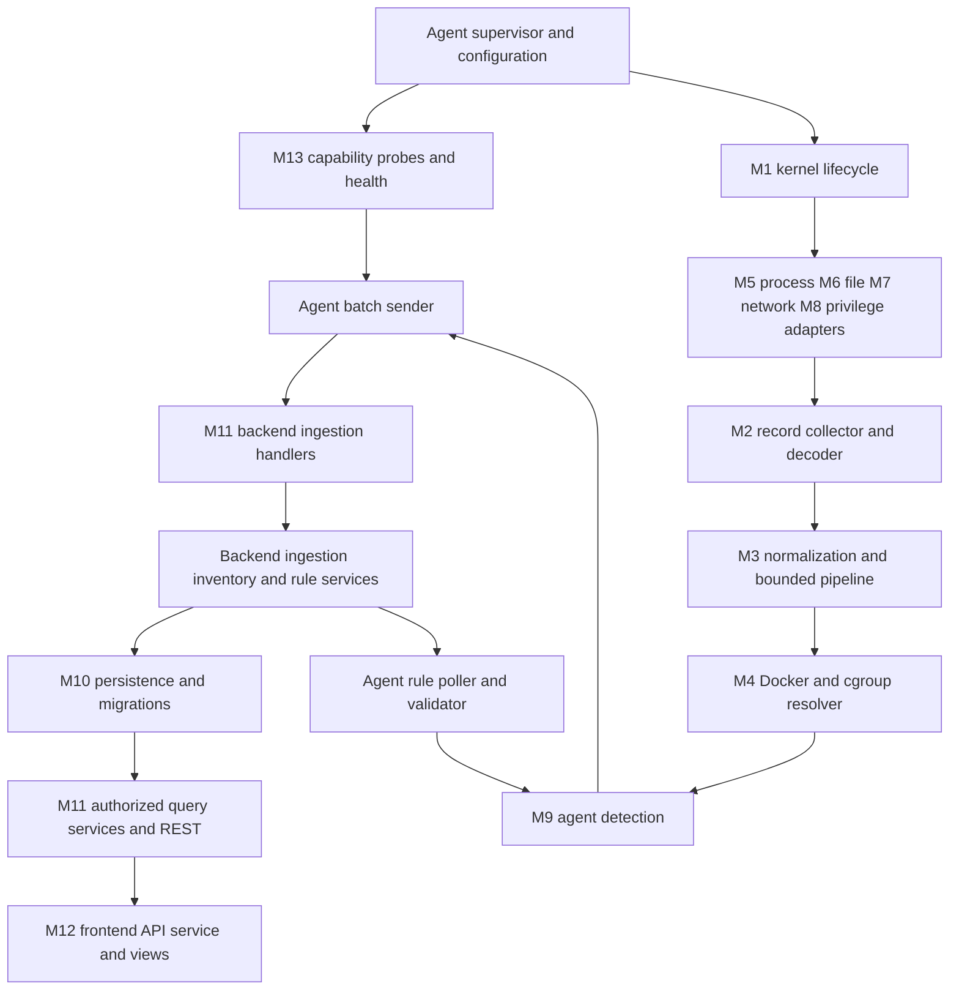
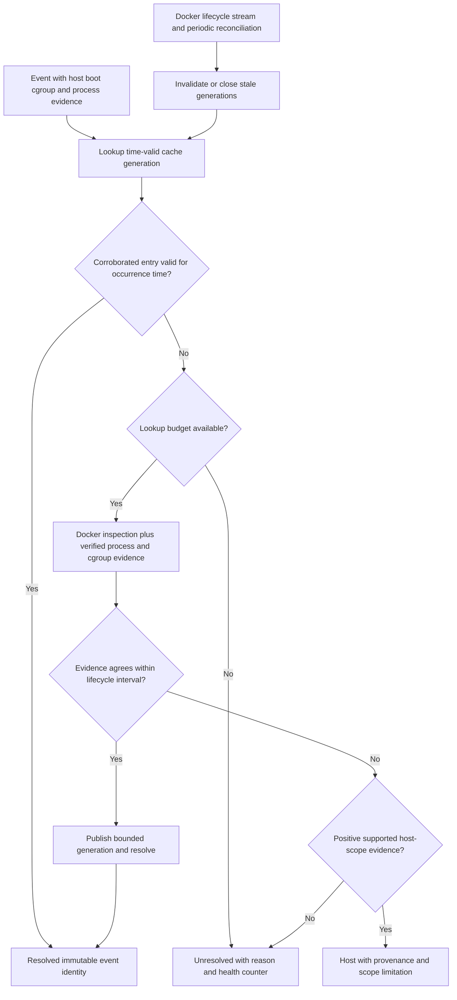

# Component design and interface contracts

## Status and conventions

Phase 1 proposal; module names and interface descriptions below are not implemented packages or verified kernel support. Follow [system architecture](system-architecture.md) and the canonical [specification](../PROJECT_SPECIFICATION.md). Keep kernel C, generated bindings, Go collection, business logic, persistence and HTTP handlers separate. Interfaces are introduced at infrastructure boundaries, not as wrappers around every function. All blocking Go operations accept cancellation/deadlines; ownership and boundedness are part of each contract.

## Responsibilities and boundary contracts

Contract types below describe module boundaries. Wire field names, encodings and validation follow [event-schema.md](event-schema.md), [api-specification.md](api-specification.md) and [database-design.md](database-design.md); review compatible evolution together before coding. No kernel ABI is directly exposed through REST.

| Module / owner | Input → output contract | Responsibility and failure semantics |
|---|---|---|
| Agent supervisor | Validated configuration and cancellation → lifecycle state | Own goroutines, queue budgets, credentials, startup order, readiness, shutdown deadline and cleanup. Reject invalid limits/configuration; no mutable global lifecycle state. |
| M1 kernel monitoring | Capability report and selected feature configuration → attached handles, bounded raw records and per-hook counters | Load reviewed objects through Cilium eBPF/generated bpf2go bindings, attach/detach, own maps/readers and probe failures. Kernel code is verifier-friendly: bounded access/strings, explicit version/size, initialized records, no unbounded loops. Do not silently substitute hooks. |
| M2 collector | Raw record bytes → validated typed kernel observations | Own reader and ABI decoder. Check supported ABI, header/record length, event type, field bounds, string termination/truncation, byte order and architecture layout before interpretation. Unknown/malformed records are counted and rejected, not guessed. Never use unsafe reinterpretation without validated layout. |
| M3 bounded pipeline | Typed observation → immutable normalized event plus identity outcome → detection delivery unit | Assign event ID once, preserve occurrence time/source/boot/cgroup/process metadata, normalize typed fields, enforce queue budgets and partition ordering. Decode, resolution, evaluation and delivery failures are distinct. Do not mutate an event after it becomes alert evidence. |
| M4 container resolver | Event-time identity evidence plus Docker/cgroup observations → resolution result | Return `resolved`, `unresolved` or positively evidenced `host`, with provenance, validity interval and reason. Bound caches, lookup concurrency, pending time and lifecycle history. Docker failure is degraded attribution, not an instruction to mark events host. Detailed algorithm below. |
| M5 process capability | Probed process hooks → process execution/creation/exit observations | Kernel-side capture plus userspace type normalization. Distinguish attempted exec, successful exec, fork/clone and exit semantics; preserve process-instance evidence. Not a second pipeline or detection engine. |
| M6 file capability | Probed selected file hooks → file action/result/path evidence | Preserve operation, flags/result where available, path provenance, truncation and namespace limitations. No contents; not a complete filesystem audit. |
| M7 network capability | Probed selected TCP hooks → connect attempt/result/state evidence | Preserve protocol, address family, endpoints, direction, namespace context and hook semantics where obtainable. No payload capture or assumption of complete traffic visibility. |
| M8 privilege capability | Probed credential/capability/namespace-related hooks → typed privilege observations | Distinguish requested credentials from confirmed state change; retain return/error evidence where available. No generalized claim of escape detection. |
| M9 agent detection | Immutable enriched events and validated immutable rule snapshot → zero or more alerts | Evaluate bounded predicates/correlation, allowlists, identity requirements and suppression. Record supporting event IDs, explanation, rule version and active set revision. Never perform enforcement. Missing evidence/unsupported fields cannot be treated as a negative fact. |
| Agent rule distribution client | Authenticated scoped rule responses → validated rule snapshot | Poll with timeout/backoff/jitter; bound response size, rule count, expressions, windows and cardinality. Validate schema, assignment, semantics and resource budget before atomic activation. Keep last-known-good on failure; report active and rejected revisions separately. |
| Agent delivery client and durable state | Frozen event/alert units → bounded durable outbox → retry requests → committed per-ID results | Persist original IDs/epochs, sequence and dedup decisions atomically with queue records before sending; recover without redetection. Bound disk/bytes/age, memory, in-flight requests and retry work. Preserve individual documents if regrouping batches; terminal errors enter bounded operator-visible dead-letter handling. Keep validated rule manifests and revalidated lifecycle state in protected local storage, not the management database. |
| M10 backend storage | Validated scoped commands/queries → transaction result or bounded query results | SQLite migrations, foreign keys, WAL, parameterized statements, controlled writer, indexes, retention and backups. Own idempotency ledger and event/alert/evidence transaction. No DB calls from agent, browser or HTTP DTO decoding. |
| M11 backend REST | Authenticated bounded HTTP request → authorized service command/query → bounded response | Separate routing/handlers, validation, authorization and business services. Bind agent principal, enforce schema/limits, expose ingestion/heartbeat/rules and management endpoints. Acknowledge ingestion only after commit; overload is retryable, invalid data is not silently skipped. |
| M12 frontend | Management REST through typed service layer → actual-data views | Overview, inventory, process/file/network activity, alerts, rules, agent health and bounded report/export workflows. Render loading, empty, stale, degraded, permission-denied and error states. Cancel stale requests; preserve server pagination/filter semantics; no eBPF or Docker knowledge in components. |
| M13 health (agent and backend) | Stage counters, capabilities, revisions and lifecycle transitions → heartbeat/status/metrics | Agent owns local truth; backend owns received-at/staleness and durable-ingestion health. Distinguish alive from monitoring-ready. Reset counters explicitly by boot/session; never fabricate throughput or loss during gaps. Health delivery has its own bounded control path. |

M5–M8 are feature modules spanning specific kernel programs and their userspace event adapters, not alternative privileged services. M10–M12 run only on the management side; M13 reports both sides without granting the backend host access.

## Normalized contracts

### Observation and event

A raw ABI header identifies ABI version, total record size and event type. Payloads use explicit-width fields and bounded arrays; generated layouts and producer/consumer agreement must be checked in Linux tests. Kernel record ABI and normalized event schema have independent versions.

The normalized envelope must retain event UUID/schema version, source hook and semantic quality, host/boot identity, agent session/sequence, kernel monotonic occurrence time, estimated UTC and conversion uncertainty, backend ingestion time separately, PID/TID and optional PPID/UID, cgroup ID, bounded command name, typed details and explicit nullable container identity/status. Process start evidence and namespace context are optional with availability markers; PID/TID alone are never durable process identities. Truncated, unavailable, redacted and empty values are distinct. Large unsigned kernel identifiers must be encoded/persisted losslessly, including in JavaScript-facing contracts; do not route them through floating-point numbers.

The decoder owns byte buffers until normalization completes. Downstream events and alerts are immutable values; reusable reader buffers must not escape. The event schema owns exact field names and compatible evolution. Unsupported versions fail closed at the boundary with diagnostic counts, not silent coercion.

### Resolver result

The resolver returns identity status, nullable Docker metadata, provenance, observation/verification time, validity interval, cache generation, freshness and unresolved reason. `resolved` requires corroborated Docker and cgroup evidence applicable to the event's host/boot/process/container lifecycle; `host` requires positive non-container scope evidence under the supported environment, not lookup failure or absence from Docker's list. Otherwise return `unresolved`. Known host scope may still have incomplete coverage of other runtimes and must be qualified accordingly.

Docker full ID is scoped by monitored host and lifecycle generation (including start/restart information). Container display names and labels are untrusted metadata, not identity keys or permission grants. Kernel cgroup ID, cgroup path and process PID are evidence, not a Docker ID by themselves.

### Detection and rules

A rule snapshot contains immutable set revision, schema/compatibility metadata, scope assignment and bounded declarative rules. Individual rules have ID/version, enabled state, severity, selectors, predicates, allowlists, window and suppression configuration where applicable. No uploaded Go, shell, BPF or arbitrary expression execution. The initial API rule language permits bounded typed conditions only, not regex or executable templates. Use three-valued evaluation for absent evidence: ordinary comparisons yield unknown, negation preserves unknown, and only final true matches; explicit availability tests are separate. Publishing a rollback still produces a new assignment revision, even if its rule contents match an older revision.

An alert contains stable UUID, schema version, rule ID/version, active set revision, severity, occurrence/evaluation times, host/boot and known container/process context, evidence event IDs, matched facts, explanation and limitations. Prefer bounded structured explanations over collecting more sensitive raw data. Derive the dedup tuple/key exactly as the event schema specifies, including fixed boot-monotonic window, rule revision, subject scope and sorted evidence IDs. Persist original alert ID/content and dedup decisions with outbox records; count bounded overlapping-match suppression separately. Alert IDs are assigned at creation, not regenerated during retries.

### Backend services and repository boundaries

- Ingestion service accepts an authenticated agent plus a fully validated batch; repository transaction either commits its events, alerts, evidence links and idempotency result together, or rolls back. Reject cross-host identity, conflicting duplicate IDs and nonexistent evidence. IDs and hashes remain immutable; server receipt timestamps are server metadata, not changes to canonical agent content.
- Inventory service accepts only active-lease-authorized complete snapshots at the next host-global revision (or an identical current-snapshot replay), without chunks. It validates bounds and freshness before replacing the projection; historical event identity is not rewritten. A partial/failed inventory update leaves the previous projection visibly stale.
- Rule service publishes immutable validated revisions through management authorization, assigns them to agents and serves only scoped revisions. Assignment success is not activation success; heartbeats report what the agent actually activated.
- Query service applies user authorization before pagination/filtering/aggregation. Repository interfaces expose domain queries, not caller-supplied SQL. Retained alerts pin their evidence; delete expired alerts/links before unreferenced events, never cascade-delete alerts merely to expire evidence. Open epochs retain idempotency receipts even after payload expiry; close epochs before collecting receipts and reject later replay. No dangling references or expired-payload resurrection.

## Container resolver lifecycle

1. Probe cgroup v2, enumerate current Docker containers and subscribe to lifecycle events, reconciling across the enumeration/subscription race. Treat discovery as incomplete until a coherent baseline is established. Reconnects and Docker daemon restarts require reconciliation rather than trusting a missed-event-free stream.
2. Inspect Docker metadata (full ID, state, start/restart information and reported init process), then verify host process start identity and actual cgroup membership against host cgroup evidence. Reading `/proc` after an event can race PID reuse; verify start identity before/after where possible and reject contradictory or temporally unsupported evidence.
3. Associate verified runtime cgroup membership with kernel cgroup identity using supported, validated host mechanisms. A systemd/cgroup path containing an ID-looking string is only a lookup hint. A current Docker PID or a path match alone is insufficient proof of event-time membership. Account for descendants and nested cgroups explicitly; parent matches cannot cross an unrelated scope.
4. Scope mappings by host boot, cgroup generation and container execution interval. A container restart can retain the Docker ID but change init process/cgroup and receives a new lifecycle UUID. Persist lifecycle UUIDs and bounded history; an agent restart requires fresh reconciliation and revalidation before reusing a saved incarnation, not creation of an invented container restart. Host reboot invalidates all live kernel-identity caches. PID/cgroup reuse must not inherit old attribution.
5. Bound pending lookups and TTLs. During a short enrichment window, unknown events can wait for corroboration. After the deadline, finalize them as unresolved and continue; do not indefinitely stall collection. Short-lived containers may disappear before inspect succeeds and remain unresolved. Cache eviction alone is not proof that a container stopped.
6. Close old validity intervals on stop/destroy/restart and retain only bounded tombstone/history evidence for late events. If a lifecycle boundary is uncertain, mark the overlapping interval unresolved. Preserve original event identity after emission; any future correction must be a separately versioned provenance-bearing feature, not silent mutation.

## Candidate hook coverage and actual-kernel probes

These are candidate strategies, not a guaranteed attach matrix. Verify BTF/layouts, program/helper types, hook existence, attach permission and actual generated behavior on every evaluated kernel. Record exact hook, attach type, object/tool versions, test, success/failure reason and semantic limitations in the capability report. No version-only support inference and no unreported fallback.

| Capability | Candidate observation and probe | Meaning and limitations that must survive normalization |
|---|---|---|
| Process | Probe scheduler exec/fork/exit tracepoints; assess exec syscall entry/exit only if attempted-exec coverage is required | Successful exec tracepoint does not report every failed exec attempt. Fork/clone concerns tasks/threads, not necessarily distinct programs. PID namespaces and host PID differ; comm is bounded, not full command history. Matching syscall entry/exit requires bounded per-thread state and missed-pair accounting. |
| File | Probe selected open/openat/openat2 and write-related syscall tracepoints; assess typed VFS/fentry or observational LSM hooks only where supported | Syscall entry is intent, exit is result; a returned descriptor does not prove bytes read/written. User path may be relative, truncated, unreadable or changed; dirfd/mount namespace/symlinks/renames/hard links complicate canonical paths. `write`/`pwrite`/`writev`, mmap, io_uring and other paths differ; selected hooks do not cover all modifications. Record successful byte count only where actually observed. No file contents. |
| TCP | Probe connect syscall outcomes and suitable socket/TCP state hooks for IPv4/IPv6 | Nonblocking connect can return in-progress and complete later. State transitions do not automatically prove application success or identify the initiating task; transitions may run in a different context. Preserve initiating cgroup/process evidence at an attributable hook or leave identity unresolved. UDP, accept/inbound flows, Unix sockets, packets, retransmission and byte volumes are not implied by selected outbound TCP coverage. NAT/network namespaces affect visible endpoints. |
| Privilege | Probe credential syscall entry/exit (setuid/setgid families, capset), namespace operations and relevant typed hooks where available | Attempt is not success; real/effective/saved IDs and capability sets differ. Namespace-relative UID 0 is not necessarily host root. File capabilities, exec transitions, user namespaces and other paths can bypass a selected syscall set. Observational LSM probes must return neutral success and never enforce. Report selected transitions, not comprehensive privilege escalation detection. |

Do not parse undocumented kernel layouts as a portability shortcut. BTF/CO-RE reduces relocation friction but does not guarantee hook semantics or helper availability. Kprobes, if later justified as fallback, require a documented fragility/coverage assessment. Each capability needs benign, failing and successful ground-truth cases; unsupported paths remain visibly unavailable.

## Planned verification obligations

Portable tests should cover decoder malformed inputs/fuzzing, immutable value ownership, queue limits/cancellation, inventory revisions, stale/reused identity, rule validation/activation, benign and suspicious detection, deduplication and batch idempotency. Privileged Linux tests must cover probes, attach/detach, hook semantics, cgroup/PID reuse, Docker restarts/short lifetimes, load-induced loss and resource cleanup. Backend tests must exercise transaction rollback, authorization, conflicting IDs, retention and out-of-order heartbeats. None of these tests has been run or passed as part of Phase 1.
