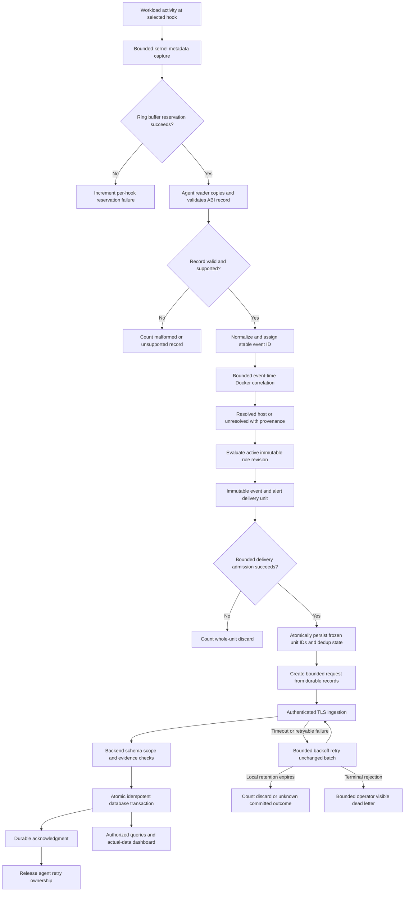
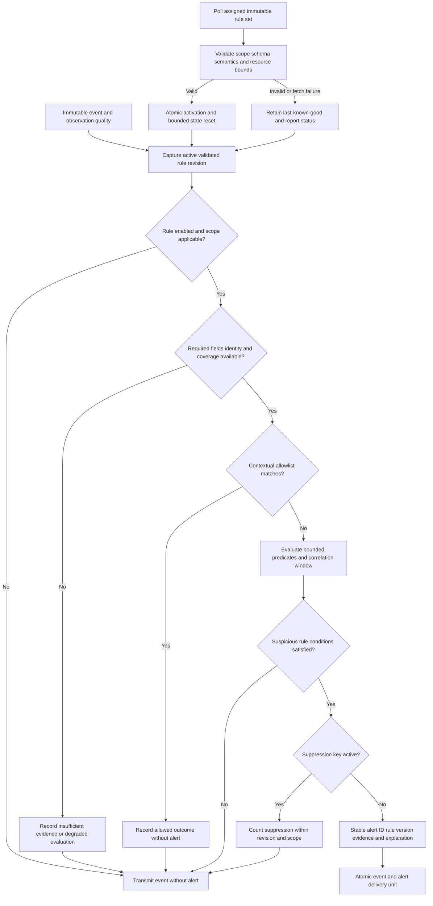

# Data flow, ordering and reliability

## Status and contract ownership

Phase 1 design only; diagrams specify intended behavior, not executed flows. Read [system architecture](system-architecture.md) and [component contracts](component-design.md). Exact event DTOs and HTTP schemas follow the separately owned [event schema](event-schema.md), [API specification](api-specification.md) and [database design](database-design.md). This document describes their pipeline implications; no independent wire format is defined here.

## Event path

### Event meaning and time

1. Record only fields safely available at the hook, with explicit unavailable/truncated markers. A syscall entry record states an attempt, not successful action. A successful hook observation still does not establish malicious intent.
2. Validate raw size/version/type before decoding; copy data out of reusable reader storage. Assign normalized UUID and session sequence once. Preserve unsigned IDs without precision loss.
3. Preserve monotonic occurrence time and host boot identity; derive UTC using sampled calibration and report uncertainty. Wall-clock steps and suspend behavior require explicit calibration handling, not assumed constant offsets. Backend receipt/ingestion time is independent. Local evaluation latency and delivery latency must not be conflated.
4. Perform bounded identity enrichment before finalizing the immutable event. Resolution can be delayed, partial or unresolved; no Docker response must not become `host`. Late metadata does not silently rewrite already-persisted evidence.
5. Evaluate at the agent with the revision captured for that evaluation. The original event remains eligible for transmission even when detection is unavailable; such a unit marks evaluation unavailable/error, increments health, and does not imply that all rules were evaluated successfully.
6. Construct a delivery unit containing the event and newly derived alerts. Correlation alerts may reference earlier events: include their original immutable evidence again unless it is known durably acknowledged and still retained. Repeated evidence must share the request's producer epoch; cross-epoch evidence, if needed, is first delivered in its own authorized historical-epoch request and then referenced after confirmed retained acknowledgment. Pin these bounded evidence records through local delivery dependencies. An expired backend payload cannot be resurrected by replay; a receipt alone cannot support new evidence. Rule validation must reject evidence/window budgets too large for configured unit/request limits. Atomically persist frozen records, sequence and dedup decisions in the bounded local outbox before sending.
7. Backend validation precedes an atomic transaction. Only committed results become visible through authorized queries; the frontend displays received history and staleness, not assumed live kernel activity.

## Queue and state budgets

All capacities are explicit configuration in records **and** bytes, with age/deadline limits where meaningful. Phase 1 sets policies, not tested numeric budgets. Choose and record concrete budgets before load evaluation. Configuration must ensure one maximum delivery unit fits a batch and one batch fits the API body limit; also bound worker count, concurrent requests, inventory/rule responses and caches. Reject invalid configurations at startup.

| Stage / state | Full, timeout or failure policy | Accountable signal |
|---|---|---|
| Kernel ring buffer and capture maps | Never wait for userspace. On reservation failure skip the record; bound per-thread correlation maps and expire unmatched entries. | Per-hook reservation failures; map insert failures; unmatched/expired syscall pairs. |
| Reader → normalization queue | Nonblocking bounded admission; drop newest record when full. Keep draining the kernel reader while possible. | Raw records read, decode rejection, normalization admission drops. |
| Normalization → resolver/detection queue | Drop newest normalized work item on overflow; never unbounded goroutine fan-out. | Accepted/evicted item count, bytes, age and pipeline-drop reason. |
| Resolver pending/cache/history | Deduplicate bounded lookups; enforce lookup deadlines/concurrency. On lookup budget failure finalize unresolved, not drop the event. Evict cache by explicit policy. | Lookup failure/timeout, unresolved reasons, stale cache, generation mismatch, reconcile gaps and cache eviction. |
| Detection windows/dedup/evidence | Per-rule/global cardinality and time limits; expire old state, evict deterministically when necessary and mark affected correlation degraded. Do not claim complete window coverage after gaps. | State eviction, late/out-of-order input, suppression count, evaluation errors and incomplete windows. |
| Delivery-unit queue | Admit or drop the entire event/alert unit; default drop newest to preserve already-owned retry work. No partial event/alert admission. | Discarded units and their constituent event/alert counts, reason and bytes. |
| Durable outbox/batch/retry state | Bound stored records/bytes/age and memory, request size, in-flight count and per-cycle retry work. Reject newest whole unit on disk-full/quota. Backoff with jitter for transient failures; park terminal failures in bounded operator-visible dead-letter state. Local expiry is explicit loss, not a success acknowledgment. | Durable admission failure, corruption, retries, rejection, expiry/dead letters, unacknowledged IDs/counts, disk usage and oldest age. |
| Heartbeat/control path | Separate bounded capacity from event delivery. Coalesce only unsubmitted latest status/snapshot; preserve monotonic revision/counter semantics. Retry submitted immutable requests without changing content. | Last accepted heartbeat, inventory revision, active rule revision, local control-path failure and server staleness. |
| Backend writer admission | Bounded writer queue and transaction duration; return retryable overload before accepting ownership if saturated. Never acknowledge queued-but-uncommitted data. | Queue depth, transaction errors, busy/latency/disk pressure and commit acknowledgment counts. |

No producer owns another stage's mutable queue contents. A single owner closes each channel; consumers do not close producer channels. Controlled workers and context cancellation must not introduce data races or silent goroutine leaks. Heartbeat failures are not added to event-loss totals as though they were missing events.

### Ordering and concurrency

Do not assume a global causal order across CPUs, hosts or ring-buffer records. Partition bounded agent evaluation by host/boot and process/container-instance evidence as required by each rule. Preserve local admission sequence, allow bounded event-time reordering, and publish the selected lateness/window policy with the rule revision. Unknown identity must not merge unrelated processes into one `unresolved` correlation key.

For the initial design, evaluate events serially within a configured partition and serialize rule activation against evaluation. Bound the number of partitions. A new revision atomically takes effect between evaluations; an evaluation keeps its captured immutable snapshot. Clear revision-specific correlation state on activation and report a warm-up interval; do not retroactively reevaluate history or mix old and new predicates in one window. Agent restart also resets windows and deduplication and is reported as a gap. This trades continuity for explainable resource use and rule semantics.

For initial delivery, prefer one in-flight event batch per agent session to simplify acknowledgment/evidence dependencies. Earlier evidence not yet acknowledged is repeated in the alert's batch; delivery ordering alone is not proof of durable persistence. Later concurrency requires the same evidence-integrity guarantees.

## Security detection flow

Policies should cover unexpected process/shell execution, sensitive file access/modification, selected privilege changes, outbound destinations and bounded process/network correlation. A shell, administration utility or root UID is not intrinsically malicious. Examples must combine relevant context such as approved image/workload, operation outcome, allowlist, destination, verified identity and related events. A file access attempt must not be explained as confirmed data theft; a TCP connect attempt must not be explained as completed exfiltration.

Rules explicitly declare identity requirements. A rule requiring a known Docker workload yields insufficient evidence for unresolved events; a host-scoped or identity-independent rule may still evaluate with an explicit limitation. Tests must include benign administration, allowed destinations, failed operations, missing fields, unresolved identity, duplicated inputs, reordered inputs and suspicious ground truth. No detection accuracy is claimed here.

Last-known-good means a completely validated and activated immutable manifest, persisted with its revision/digest for restart. Revalidate saved schema, digest, scope and resource/capability compatibility before reuse; atomic local replacement must not leave a half-written active set. If no valid set is available on initial startup or after restart, continue collection with detection unavailable and report it; do not invent built-in production rules. Poll failure leaves the active set running but marked stale according to policy. A hard expiry, if required, must explicitly disable evaluation rather than silently alter rule semantics.

## Atomic ingestion and idempotency coordination

`POST /api/v1/agent/events` carries exactly the bounded `events` and `alerts` arrays defined by the API. Documents are immutable; request grouping is not an idempotency key. The intended protocol is:

1. Register the producer epoch through authenticated heartbeat and publish immutable capability/clock manifests before referenced events. Authenticate ingestion, bind host scope, enforce one host/boot/epoch per request, bound sizes and validate schemas, source/calibration/rule provenance and evidence before acknowledgment. Historical registered open epochs may deliver without authority over current inventory.
2. Use `(host_id, event_id)` and `(host_id, alert_id)` with canonical JSON comparison as specified by the shared contracts. Enforce epoch sequence and alert dedup tuple uniqueness as well. Duplicate IDs inside a request are invalid. Exclude backend receipt metadata from canonical producer content.
3. In one transaction, compare payloads/receipts, insert new events, validate evidence ownership, insert new alerts/links and durable receipts. Same ID/content is replay; conflicting ID/content, sequence or dedup identity rejects the whole request. Acknowledgment returns committed per-ID results, not an invented batch-ledger result.
4. Evidence must be included or retained on the same host/boot; unknown or expired evidence rejects the request. Alerts pin evidence until they expire. A pruned event's receipt supports idempotency only: replay reports expired payload and never resurrects it or makes it usable as new alert evidence.
5. Commit before acknowledging. A lost response permits unchanged object retries. A 413 may permit regrouping/splitting arrays while preserving individual documents and same-request evidence dependencies; one oversize object is terminal. Validation failure, disk-full, failed commit and overload never produce success.
6. Keep receipts for the entire open ingestion epoch, including beyond payload expiry. Close a historical epoch atomically before collecting its receipts, retain its closure tombstone and reject future delivery with `epoch_closed`. The database/API contracts own provisional closure policy; local outbox age may be shorter. Never relabel old records into a new epoch to bypass closure.

This contract does not recover observations lost before kernel emission, before durable local admission, discarded locally or damaged in unrecoverable storage failure. An expired unacknowledged batch may have committed despite a lost acknowledgment: count it as **delivery outcome unknown**, not definitely unpersisted. Stable IDs prevent retry duplication, not all semantic duplicate observations from overlapping hooks; preserve source and correlate those intentionally.

## Heartbeat and inventory synchronization

The baseline uses `POST /api/v1/agent/heartbeat` for health, producer-epoch registration and complete inventory snapshots. Session below means the API's `agent_epoch_id`; the API owns wire fields and active host-lease rules. Semantics are:

- Heartbeat carries agent/host/boot/session identity, monotonically increasing status sequence, observed time, active rule revision, capability report, stage counters, queue pressure, resolver freshness and inventory revision/completeness.
- Backend tracks registered/current session, receipt time and status sequence. A late heartbeat cannot overwrite a newer status, resurrect a superseded session or reset counters invisibly. Re-registration after agent restart must establish a new session; host reboot also changes boot identity.
- Initial registration is health-only, obtains the current host-global inventory revision and establishes the active lease under the API rules. Send complete bounded snapshots after reconciliation and periodically. The next snapshot revision is current + 1 across boots/agent epochs; only identical current-snapshot replay is permitted at the same revision. Lease loss or revision conflict requires reconciliation, not forced overwrite.
- One full successful reconciled enumeration/inspection of all Docker containers fits one request; chunking and `complete=false` are not supported. Incomplete, unstable or oversized collection sends `inventory=null` with degraded health, never a prefix list. A rejected oversized request changes neither status nor inventory; send a new health-only heartbeat ID/sequence. Contract capacity changes require review.
- Absence from an accepted authoritative complete snapshot marks a prior current-container projection no longer current; it does not delete historical events or prove exact stop time. Never apply deletion from an incomplete/stale snapshot. Docker unavailability means inventory unknown/stale, not an authoritative empty inventory.
- A delayed event may legitimately reference an exited container absent from current inventory. Store evidence metadata as history; do not reject it solely because it is not currently running. Do not let it reactivate the current inventory projection.

## Agent-local durability and recovery

The outbox is a bounded protected host-local journal/store, not authoritative management persistence and not an agent REST service. Its concrete format/dependency is deferred; Phase 1 adds neither. It must atomically commit original frozen events/alerts plus sequence and dedup decisions, retain evidence dependencies, detect incomplete/corrupt writes and recover only verified records. A record is locally durable only after the selected write/sync boundary; document filesystem/power-loss assumptions and test them rather than claiming arbitrary-crash safety.

Use a single controlled writer and bounded reads/transactions, restrictive file permissions, configured disk/age quotas and monitored free space. Reject newest complete units on quota/full-disk rather than silently evict evidence or block kernel collection. Dead-letter metadata/records also have quotas and expiry with discard counts; do not move an unbounded backlog into another directory. Delete acknowledged records only when no pending evidence dependency needs them. A terminal `epoch_closed`/schema/conflict failure requires visible operator reconciliation, never ID regeneration or old-epoch relabeling.

On restart, register the new current epoch/lease before publishing current health. Recover old documents under their original registered epochs and publish any missing saved provenance records before delivery; old data cannot change current inventory. Restore and validate the last-known-good rule manifest and saved lifecycle UUID evidence, then reconcile runtime state before using mappings. Do not restore partially evaluated correlation windows as if no gap occurred. Protect saved manifests and provenance against accidental corruption; local hashes are consistency checks, not protection from root tampering. Disk encryption/key handling remains deployment policy and metadata-at-rest remains a threat-model risk.

## Loss, health and shutdown semantics

### Honest accounting

Counters are cumulative per explicitly identified boot/session and source; backend derives deltas only within the same epoch and nondecreasing sequence. Record stage inputs, outputs, filtered items, failures and current buffered count where measurable. For a stable stage interval, reconcile accepted input against forwarded, intentionally filtered, dropped and still-buffered work, allowing for in-flight work. Events, alerts, batches and bytes are different units; do not sum them into an invented overall loss percentage.

Kernel reservation failures are separate from decoder rejection, queue drops, resolver unresolved outcomes, correlation eviction, suppression, batch rejection and unknown delivery outcomes. A deliberate rule nonmatch is not a loss; unresolved attribution is not transport loss. Kernel counters should be read before maps close when possible, but process crash/host crash can lose final counters. Unobserved hooks, unmeasured map failures, intervals before attachment and reporting gaps may have unknowable event counts. Display unknown coverage/gaps instead of zero. Backend duplicate retries are not new collected events.

Readiness requires the critical capture path, valid pipeline configuration and functioning local processing; detection availability, resolver freshness and backend reachability are reported separately. Heartbeats cannot prove that a compromised agent is truthful. Backend staleness uses receipt time and a configured threshold, not agent wall time alone.

### Bounded shutdown order

1. Enter stopping state, reject new configuration/rule activation and stop starting Docker refresh/poll operations. Keep necessary drain and delivery tasks alive; use separate cancellation scopes rather than canceling all workers at once.
2. Detach/disable producers, then drain records already in the ring buffer using the supported reader mechanism until quiescent or the shutdown deadline. Count the race/coverage boundary and snapshot kernel counters before closing maps where possible.
3. Close downstream queues in producer order. Finish or time out pending identity lookups, finalizing unresolved when appropriate; drain normalization and detection. Expire remaining correlation windows without inventing alerts from absent evidence.
4. Persist admitted delivery units and dedup/sequence state, then attempt bounded batches until the deadline. Stop retries at expiry but retain committed outbox records with original boot/epoch/IDs for recovery. Count unsaved/discarded local work separately from durably queued work and unknown outcomes of in-flight requests.
5. Attempt a final bounded heartbeat with stopping status and counters after draining. Its failure is itself a reporting gap, not proof that shutdown succeeded remotely. Close Docker subscriptions, readers, links, maps and HTTP clients; join workers and release resources even on earlier errors.

A normal drain attempts delivery; it cannot guarantee no loss. Forced termination skips drain and can destroy non-durable buffers and counters; previously committed outbox records require verified recovery. Backend shutdown separately stops new writes, finishes or rolls back bounded transactions and closes SQLite; browser failures never cancel already-committed ingestion.

## Planned validation, not results

Required experiments include queue saturation at every boundary, lost acknowledgments, duplicate/conflicting IDs, transaction rollback, oversize evidence units, disk-full, API outage, stale sessions, partial inventory, invalid rule updates, rule warm-up gaps, out-of-order events, agent/Docker/host restart and deadline-driven shutdown. Reconcile measured stage counts and unknown intervals under controlled Linux workloads. None has been executed in this documentation task.
