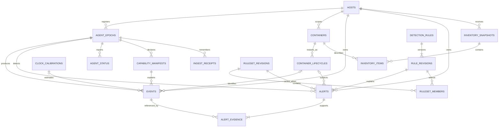

# Persistence design

**Status:** Phase 1 design revision 1; no SQL migrations, database, throughput or retention behavior has been implemented/tested. This document refines [PROJECT_SPECIFICATION.md](../PROJECT_SPECIFICATION.md) and shares contracts with [event-schema.md](event-schema.md) and [api-specification.md](api-specification.md).

## 1. Storage and ownership

The management backend owns SQLite. Agents own separate bounded durable delivery queues; the agent cannot open the management database. The browser uses only authenticated management APIs. Persistence adapters use parameterized statements, context deadlines and explicit transactions; handlers do not construct SQL from user strings.

Enable `foreign_keys=ON` on **every connection**, WAL journal mode and `synchronous=FULL` initially. Verify applied settings at startup; do not assume PRAGMA success. Use one bounded application write queue and one controlled writer connection. Read connections are bounded and short-lived per query/transaction. Do not hold write transactions during Docker inspection, network I/O, rule compilation or bulk JSON validation. Validate first, then recheck authorization/epoch/revision and integrity conditions within the write transaction.

**Provisional design values, not benchmark results:** writer queue 128 operations; SQLite busy timeout 2000 ms; ordinary write deadline 5000 ms; read deadline 3000 ms; maintenance deletion batches 500 rows; WAL checkpoint review every 60 s with an initial 64 MiB WAL alert threshold. Queue exhaustion returns bounded retryable backpressure, not unlimited goroutines. Passive checkpoints must not monopolize the writer; investigate long readers, disk space and checkpoint failures. Do not delete WAL/SHM files while running. Disk-full/commit failure must not return a success response.

## 2. Representation invariants

- UUIDs, Docker IDs, hashes and enums are constrained `TEXT`; uint64 values are canonical range-validated decimal `TEXT`, including revisions, cgroup IDs, monotonic times, sequence numbers and counters. Enforce range/format in validated writes plus database checks where feasible. SQLite signed `INTEGER` must not hold arbitrary uint64 values.
- Small bounded values such as PID, UID, ports and booleans can use SQLite `INTEGER`; signed syscall return values remain canonical `TEXT` to match the wire contract.
- Canonical UTC wall times are fixed-width `YYYY-MM-DDTHH:MM:SS.nnnnnnnnnZ` `TEXT`. Lexical indexing is valid for that normalized range/format only. Nullable occurrence time is distinct from non-null backend ingestion time. Keep original monotonic domain, calibration ID and uncertainty in the immutable document.
- Decimal text ordering is **not numeric ordering** (`"10" < "2"` lexically). Equality indexes use canonical text; monotonic/revision range operations compare digit length then lexicographic value, or a validated 20-digit zero-padded derived sort key. Never cast uint64 text to signed SQL integer. Increment revisions in checked Go uint64 arithmetic; overflow is an explicit error.
- Store the validated immutable submitted document as canonical JSON plus SHA-256 digest. Canonicalization is RFC 8785 over the validated document (no floats or integers outside the schema's safe small integer fields). No Unicode normalization is applied. Digest includes IDs and submitted timestamps but excludes backend `ingested_at`. Strict validation rejects duplicate JSON keys before canonicalization. Compare canonical content as well as the hash on a retry when payload is retained; a retained receipt uses its cryptographic digest.
- Indexed columns are projections of the same validated document, populated in one transaction. They must not disagree with its host, boot, epoch, identity, rule or timestamp. Database `CHECK`s cannot replace cross-document validation.

## 3. Entity model

The diagram shows relationships, not SQL DDL. Composite foreign keys below are normative; an ID-looking string is never a substitute for host scope.

| Table | Primary key and important data / constraints |
|---|---|
| `hosts` | `host_id`; enrollment/display metadata, creation time, current boot and active agent epoch/lease references, current accepted inventory revision, last contact, administrative state. Names/IPs are mutable labels, not keys. |
| `agent_epochs` | `(host_id, agent_epoch_id)`; unique `(host_id, boot_id, agent_epoch_id)` for full foreign keys; boot ID, principal registration, registered/last-ingest times, lease generation, state `active`, `historical` or `closed`. At most one active lease per host; boot linkage is immutable. |
| `containers` | `(host_id, runtime, container_id)`; current metadata projection, first/last seen, `inventory_presence` (`present`, `absent`, `unknown`), inventory revision and source (`inventory`, `event_reported`). An event-created row is not authoritative inventory. Runtime initially `docker`. |
| `container_lifecycles` | `(host_id, runtime, container_id, lifecycle_id)`; parent container FK, boot ID, Docker started/finished timestamps (nullable), cgroup ID text, observation bounds and uncertainty, actual observed runtime state, metadata provenance. Also unique full key including boot for event/alert FK validation. Never overwrite an old lifecycle on restart. |
| `inventory_snapshots` | `(host_id, inventory_revision)`; boot, producer epoch, snapshot UUID, capture start/end and captured time, received time, canonical content digest and item count, authoritative-complete marker. Revision is host-global across epochs. Store one complete snapshot atomically; reject chunks. |
| `inventory_items` | `(host_id, inventory_revision, runtime, container_id)`; snapshot and container composite FKs, nullable lifecycle ID, immutable per-snapshot metadata and observed runtime state. Historical items do not change when current projection changes. |
| `capability_manifests` | `(host_id, coverage_id)`; immutable boot/producer epoch, actual kernel/architecture, feature probe and attachment semantics, canonical document/digest. Full host/boot/epoch FK; an existing ID cannot change content. |
| `clock_calibrations` | `(host_id, calibration_id)`; immutable boot/producer epoch, clock domain, bracketed samples, conversion assumptions/bounds and synchronization uncertainty, canonical document/digest. Full host/boot/epoch FK. |
| `events` | `(host_id, event_id)`; schema, boot, epoch, sequence, type/action, source/coverage, nullable occurrence time, received time, first backend ingestion time, monotonic text/sort key, identity status, cgroup text, nullable runtime/container/lifecycle composite FK, PID/task-start projections, canonical JSON and digest. Unique `(host_id, agent_epoch_id, sequence)`. |
| `alerts` | `(host_id, alert_id)`; boot/epoch, rule ID/revision, ruleset revision, severity, nullable container/lifecycle composite FK, detected time, first ingest time, monotonic window, dedup version/key, immutable canonical JSON and digest. Unique `(host_id, dedup_version, dedup_key)`. |
| `alert_evidence` | `(host_id, alert_id, event_id)`; composite FKs to alert and event, stable display ordinal unique per alert. Validator checks host/boot and evidence bounds; no cross-host evidence. |
| `detection_rules` | `rule_id`; current revision pointer, created time, management scope (`global` initially), retired flag. Logical deletion is retirement, not erasure of history. |
| `rule_revisions` | `(rule_id, revision)`; immutable validated rule document, rule schema version, enabled flag, digest, editor principal and commit timestamp. Revisions strictly increase per rule. |
| `ruleset_revisions` | `ruleset_revision` uint64 text; immutable manifest, digest, created time, publication state. Initial distribution is one global ruleset for enrolled hosts; future host targeting requires a new explicit scope contract. |
| `ruleset_members` | `(ruleset_revision, rule_id)`; FK to `(rule_id, revision)` and manifest. Includes disabled revisions so agents can remove prior enabled rules. A ruleset is an exact set, not a delta. |
| `agent_status` | `(host_id, agent_epoch_id)`; latest accepted heartbeat sequence/ID/digest, reported and backend received times, capabilities/clock manifest, applied ruleset revision, inventory state, categorized counters with counter-generation IDs, queue depths and degradation reasons. Keep a bounded history in separate `agent_status_history` keyed by host/epoch/sequence. |
| `ingest_receipts` | `(host_id, kind, object_id)` with kind `event`/`alert`; epoch, canonical digest, first ingestion time and payload-retained flag. Retain event sequence uniqueness and alert dedup uniqueness via corresponding receipt columns/partial unique indexes after payload pruning. |

A normalized process table is deferred: PID alone is not a key. If later needed, its key includes host, boot, host PID and observed task start monotonic time, with incomplete identities kept separate. No fabricated process row is necessary for current event storage.

### Foreign keys and historical integrity

Every resolved event/alert references its full host/runtime/container/lifecycle and boot combination. Every producer references `(host_id, boot_id, agent_epoch_id)`. Resolved identity requires non-null lifecycle components; host/unresolved require all those container FK components null, with raw cgroup retained independently. Use composite keys and explicit checks because SQLite permits partial-null foreign keys.

An event can arrive before inventory. In the same transaction create provenance-labelled `event_reported` container/lifecycle reference rows from the event's submitted snapshot, without claiming a current running state or authoritative membership. Later inventory reconciles projections; conflicting boot/lifecycle facts fail validation rather than rewrite historical records. Unresolved events do not create guessed container records.

Events reference the same-host/boot capability manifest and, if non-null, clock calibration through composite foreign keys. These immutable records are published in heartbeat before event ingestion; they survive removal of short-lived status history and remain while any event references them or their producer ingestion epoch remains open. A current authorized agent may replay frozen historical metadata records without gaining permission to change historical health, leases or inventory. Rules/rulesets referenced by alerts and lifecycles referenced by events/alerts have `RESTRICT` deletion. Alert deletion cascades only its own `alert_evidence` links; deleting an event never cascades alerts/evidence. Inventory history cleanup deletes snapshot items but does not cascade into container/event history. Retired containers/hosts are not hard-deleted while retained data or ingestion receipts reference them.

## 4. Transaction contracts

### Atomic ingestion

One `POST /api/v1/agent/events` transaction covers the complete `{events, alerts}` batch:

1. Strictly validate bounds, schemas, identity consistency, immutable rule references and evidence; authorize the principal for the submitted host/registered boot/epoch.
2. Begin the controlled write transaction; recheck epoch acceptance and authorization generation. Resolve all duplicate IDs, sequence collisions and dedup keys against payloads and receipts.
3. Same scoped ID + same canonical content is replay: no event/alert mutation and no new ingestion timestamp. Same ID + different content, reused sequence, or same alert dedup key + different ID is a conflict. Any conflict rolls back the entire request, including otherwise new events.
4. Insert new event rows and required historical reference rows; resolve alert evidence from retained existing events or this batch, then insert alerts and links. Same-request evidence is supported regardless of array order. Missing/expired evidence rejects the whole request; a pruned event receipt alone is not usable evidence.
5. Insert receipts and commit. Only after successful commit acknowledge per-ID results. A timeout/disconnect can be ambiguous; the agent retries identical IDs/documents. A failed commit produces no partial success.

A replay whose payload was pruned is acknowledged as replay with `payload_state=expired`, not reinserted. It cannot make deleted evidence available to a new alert. Receipts also preserve sequence/dedup uniqueness after retention. Duplicate IDs within one request are invalid even if identical, to keep responses unambiguous.

### Heartbeat and inventory

Heartbeat health is scoped to the active lease/boot/epoch; historical delivery of event batches does not authorize health/inventory takeover. Its sequence and digest prevent rollback or changed-content replay. Exact latest heartbeat retry returns its original acknowledgement; lower sequences fail. Sequence jumps are allowed and reported as gaps, not assumed kernel loss.

An optional inventory is **one bounded, complete Docker snapshot**, not a chunk or partial patch. Its host-global revision must equal current revision + 1, or equal current revision with identical snapshot ID/digest for a replay. Different content for the same revision and stale/skipped revisions fail. Validation, snapshot/items insertion, container projection changes, absent marking and heartbeat update commit together. No partial deletion is possible. Concurrent new epochs cannot publish under an old lease.

A container omitted from a successfully accepted complete snapshot is `inventory_presence=absent`; retain its record/lifecycles. Absence is not proof of a precise removal/stop time or a successful exit. Partial Docker listing/inspection, unstable reconciliation, oversize, stale lease or parse failure results in **no inventory replacement** and preserves the last good snapshot; health reports stale/degraded inventory. Current inventory remains explicitly stale if the agent is offline. See API for complete-snapshot limits and collector failure handling.

### Rule updates

A management update validates a full rule and checks its current ETag/revision within the transaction. Append a new immutable rule revision, append/publish the next global ruleset manifest with that new member revision, and advance current pointers atomically. Never change old policy content, silently edit an active revision, or publish half a manifest. Concurrent edits fail their precondition. Authorization/audit identity and timestamp are recorded; no secrets or full credentials enter audit logs.

Agents report applied revision separately from backend desired revision. Offline agents can produce alerts under a known historical revision; the backend validates membership and retains that policy history. It does not relabel historical detections with current rules.

## 5. Index and query plan

Initial indexes (to verify with `EXPLAIN QUERY PLAN` and representative data later):

- Events: `(host_id, ingested_at, event_id)`, `(host_id, observed_at, event_id)` excluding null occurrence times; cross-host equivalents only for authorized management queries needing them.
- Events by subject: `(host_id, runtime, container_id, lifecycle_id, observed_at, event_id)` and `(host_id, identity_status, ingested_at, event_id)`; type/action/time index for selected frequent dashboard filters.
- Event task/cgroup correlation: `(host_id, boot_id, pid, task_start_sort_key, monotonic_sort_key)` and `(host_id, boot_id, cgroup_id, monotonic_sort_key)` where known. A bare PID/cgroup index does not establish attribution.
- Alerts: `(host_id, detected_at, alert_id)`, `(host_id, severity, detected_at, alert_id)`, `(host_id, rule_id, rule_revision, detected_at, alert_id)`, subject/time index; unique dedup index mirrored in receipts.
- Evidence: reverse `(host_id, event_id, alert_id)` for retention checks.
- Containers: `(host_id, inventory_presence, runtime, container_id)`; lifecycles by `(host_id, runtime, container_id, boot_id, start_time)` with explicit null/uncertainty handling.
- Heartbeat history `(host_id, received_at, agent_epoch_id, sequence)`; rule manifest membership/revision FKs; receipts unique sequence and dedup indexes plus epoch lookup for cleanup.

Use keyset pagination on a declared time and ID tie-breaker. Bound date ranges and aggregate bucket counts. No wildcard SQL identifiers or unbounded query supplied by a client. Avoid full JSON scans for list queries; load the canonical document only for bounded results/details. Do not claim all combinations are fast; evaluate and add indexes based on measured query plans and write costs.

## 6. Retention, retries and capacity

**Provisional configurable defaults, not tested storage capacities:** raw event target 7 days, alert target 30 days, heartbeat history 7 days, superseded inventory snapshots 7 days. Retention age uses first **backend ingestion time**, not potentially skewed event wall time. Keep the latest accepted inventory snapshot even when older than the history target, labelled stale.

An alert pins every evidence event until the alert expires. Thus a seven-day event target is not a hard maximum: evidence for a thirty-day alert can outlive it. In bounded transactions, delete expired alerts and their links first, then old unreferenced events; `RESTRICT` plus link checks prevents dangling evidence. Events referenced by any retained alert survive. Historical rule revisions, epoch/boot linkage and lifecycle rows needed to explain retained data also survive. No automatic cascading removal of alerts when an event expires. API detail responses distinguish retained, expired and unknown IDs using receipts.

Receipts outlive payloads for the entire open ingestion epoch; otherwise an old retry could resurrect expired data. A historical epoch can be administratively/automatically closed after a **provisional 90 days without accepted ingestion**, only if it is no longer the active epoch. Closure and rejection of future ingestion for that epoch happen atomically **before** receipt collection; retain a compact closed-epoch tombstone while host enrollment exists. A closed epoch returns `410 epoch_closed`, even for an old retry. After closing, its receipts may be collected without permitting resurrection. Active epoch receipts can grow beyond the payload retention window; provision disk budgets, monitor growth and stop accepting new writes with explicit backpressure rather than silently evicting dedup state. Rotating/closing epochs is a controlled protocol action, never a consequence of payload expiry alone.

Default retry remains possible while an epoch is open; agents surface `epoch_closed` as terminal delivery failure rather than relabeling records into a new epoch. Lost credentials do not justify bypassing host scope. Host decommission/erasure requires a separate explicit administrative procedure including tombstones and authorization revocation; no public delete endpoint is designed here.

Disk-pressure policy: alert early, run bounded allowed retention, then reject ingestion with retryable storage-unavailable errors and expose degraded health. Do not silently shorten evidence retention, delete rules referenced by alerts, acknowledge undurable writes or invent missing data. Counters distinguish accepted writes, replays, invalid/conflicting requests and retention deletions.

## 7. Migrations, recovery and validation intent

Maintain ordered migration files with version, checksum, application version and applied UTC time in `schema_migrations`. Apply migrations exclusively before serving writes; verify SQLite version/features in Phase 2, pin compatible dependencies then, and abort startup on unknown versions/checksum mismatch. Use transactions where SQLite supports them; staged rebuilds require documented rollback/recovery and space checks. Schema migrations never silently reserialize immutable documents under the same schema version. Breaking event changes require compatible readers, explicit migration provenance, and preserved original identity/digest or a new versioned representation.

Use SQLite's consistent backup mechanism or a coordinated checkpoint/backup procedure, not an arbitrary copy of only the live `.db` file. Backups include credentials only through separately secured configuration, never event logs; restrict file permissions and document encryption-at-rest deployment requirements. Restore must preserve enrollment, epochs, receipts, rules, IDs and latest inventory revision. A restore can roll back acknowledged commits: declare the recovery point, reconcile agents using identical replays, and never assert zero data loss without evidence. Run integrity and foreign-key checks after migrations/restore; quarantine corruption rather than silently repairing evidence.

Planned validation (not run): transaction rollback on mixed new/replayed/conflicting batches; dropped acknowledgements; uint64 extremes and numeric sort; concurrent rule ETags and epoch leases; complete inventory omission versus failed/oversized snapshots; restart histories and event-before-inventory provenance; expiry while alerts pin evidence; closed-epoch retry rejection; queue/disk-full/backpressure; migration checksums and backup/restore; query plans and WAL/checkpoint behavior under controlled load. No SQL source or Phase 2 implementation is authorized by this document.
