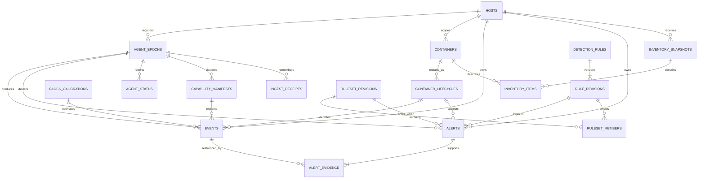

# Persistence design

**Status:** PostgreSQL design revision 2, refining the canonical [PROJECT_SPECIFICATION.md, revision 2](../PROJECT_SPECIFICATION.md). Phase 2 portable foundation is approved and in progress, not accepted; Ubuntu target/kernel evidence is unknown on the macOS development host. No SQL migrations, database, throughput or retention behavior has been implemented/tested here. Shared contracts: [event-schema.md](event-schema.md), [api-specification.md](api-specification.md), [decision D12](technical-decisions.md#d12--backend-owned-postgresql-and-authorized-rest).

## 1. Storage and ownership

The management backend owns PostgreSQL **17**. Phase 2 [development Compose](../../deploy/compose.yaml) pins `postgres:17.11@sha256:3b0cda93be7c8dba2ed484d19393d93845dc3dafb88973e248ba8e6d99d784e1`; [deployment evidence and limitations](../../deploy/README.md) record official tag/index metadata verification on 2026-11-02, not an image pull or Docker/database run. This configures only a local database foundation, not the future application roles, schema or repository. Intended Go driver: **pgx v5**, with exact compatible module pin, pool implementation, migrations and repository implementation deferred to approved Phase 7. Phase 2 must not add a fake database repository or eagerly import a driver. Agents own separate bounded durable delivery queues; the agent cannot connect to the management database. The browser uses only authenticated management APIs. Persistence adapters use parameterized statements, context deadlines and explicit transactions; handlers do not construct SQL from user strings.

Use a bounded connection pool and bounded application admission, not a global single writer. Ordinary transactions use `READ COMMITTED` plus explicit row locks, unique constraints and idempotency checks (§4). Keep transactions short; never hold locks during Docker inspection, network I/O, rule compilation or bulk JSON validation. Validate first, then recheck authorization/epoch/revision and integrity conditions inside the transaction. Session defaults and effective role/settings must be verified at startup; database constraints remain active for every connection.

Require `fsync=on`, `full_page_writes=on` and `synchronous_commit=on`; acknowledge ingestion only after successful commit with durable local WAL flush. Do not use unlogged tables for telemetry, receipts or protocol state. This does not imply synchronous replication, zero-loss failover or guaranteed storage hardware honesty. Replication/failover guarantees need a separately reviewed deployment policy.

**Provisional design values, not benchmark results:** at most 16 application pool connections per backend instance (minimum idle 0), 128 admitted waiting operations, pool acquisition deadline 1000 ms, ordinary write deadline 5000 ms, read deadline 3000 ms, `lock_timeout` 1000 ms, write/read `statement_timeout` 4000/2500 ms, `idle_in_transaction_session_timeout` 5000 ms, maintenance batches at most 500 rows. All retries fit the original deadline. Account for all instances, migration/backup/maintenance connections and reserved administrative capacity within server `max_connections`; do not multiply pools without a budget. Queue/pool exhaustion returns bounded retryable backpressure, not unlimited goroutines. Monitor pool waits, lock waits, WAL generation/archive lag, checkpoint latency, dead tuples/autovacuum, long transactions, replication-slot WAL retention if configured, and data/index/temporary/backup disk usage. Set explicit deployment disk alerts/quotas and query temporary-file limits after capacity review; no inherited file-WAL threshold is presumed suitable. `max_wal_size` is a checkpoint target, not a hard WAL disk cap: bound archive failure/replication-slot retention where configured and reject ingestion before disk exhaustion rather than delete required WAL. Autovacuum must remain enabled; monitor transaction-ID age as well as bloat. Routine vacuum reuses space but does not promise filesystem shrinkage. Do not manually remove PostgreSQL WAL/data files. Disk-full/commit failure must not return success.

Use a dedicated schema and separate migration owner and least-privileged runtime application role. Runtime has only needed DML/sequence privileges, no superuser, role creation, schema ownership or DDL; restrict PUBLIC schema creation, fix a trusted `search_path`, restrict network access and use SCRAM credentials kept out of source/logs. A separately controlled backup role receives only required access. Remote database connections require certificate/hostname verification (`sslmode=verify-full`, trusted CA); never use `prefer`, `require` without verification, or verification bypass as a remote security policy. Database volumes, backups and optional WAL archives require restricted ownership/permissions and deployment encryption/key management.

## 2. Representation invariants

- UUID identifiers use native `uuid`; Docker IDs, hash hex and enums use bounded/checked `text` (hash bytes may instead use length-checked `bytea`). Every uint64 projection uses `NUMERIC(20,0)` with `CHECK (value >= 0 AND value <= 18446744073709551615)`, including revisions, cgroup IDs, task-start/monotonic nanoseconds, sequences and counters. Nullable fields allow null, not a fabricated zero. Decimal strings remain unchanged on the wire and inside immutable documents. Validate integer syntax/range before binding: numeric scale coercion must not silently round a fractional input. Never pass identifiers through floating point or cast arbitrary uint64 to signed `bigint`.
- PID/TID/UID/GID/CPU unsigned 32-bit projections use `bigint` with `CHECK` bounds 0..4294967295; ports use `integer` with bounds 0..65535; booleans use `boolean`. Signed int64 syscall results may use `bigint` projections, retaining decimal strings in the immutable wire document.
- Wall-time projections use `timestamptz(6)` with UTC connection/output settings with finite design range 1970-01-01 through 9999-12-31; reject infinity/out-of-range values. PostgreSQL stores microseconds, not nanoseconds. Before binding, explicitly **truncate toward the earlier microsecond**, not driver/server-dependent rounding, and retain a `smallint` nanosecond remainder 0..999 for each precise occurrence/detection timestamp. `(observed_at, observed_at_ns_remainder)` / `(detected_at, detected_at_ns_remainder)` reconstruct the exact normalized nine-digit timestamp; nullable pairs must be both null or both non-null. Preserve the exact submitted nanoseconds in the immutable document as well. Backend-assigned ingestion/receipt timestamps have microsecond precision and render as nine digits with the final three zeros; do not manufacture sub-microsecond precision. Keep monotonic domain, calibration ID and uncertainty independently.
- Numeric columns supply numeric ordering directly; no digit-length/zero-padding sort keys. Checked revision increments occur under the appropriate row lock and cannot exceed uint64 maximum. Overflow is an explicit error, never wraparound.
- Store the validated immutable submitted document as canonical JSON plus SHA-256 digest. Canonicalization is RFC 8785 over the validated document (no floats or integers outside the schema's safe small integer fields). No Unicode normalization is applied. Digest includes IDs and submitted timestamps but excludes backend `ingested_at`. Strict validation rejects duplicate JSON keys before canonicalization. Compare canonical content as well as the hash on a retry when payload is retained; a retained receipt uses its cryptographic digest.
- Store canonical RFC 8785 UTF-8 bytes in `bytea` (or exact canonical `text`) separately from any optional `jsonb` query projection. JSONB reorders/normalizes representation and is **not cryptographic canonicalization**; never hash JSONB serialization or reconstruct the authoritative document from it. Duplicate-key rejection precedes JSONB conversion. Preserve canonical bytes and digest on upgrades/replays.
- Indexed columns are projections of the same validated document, populated in one transaction. They must not disagree with its host, boot, epoch, identity, rule or timestamp. Database `CHECK`s cannot replace cross-document validation.

## 3. Entity model

The diagram shows relationships, not SQL DDL. Composite foreign keys below are normative; an ID-looking string is never a substitute for host scope.

| Table | Primary key and important data / constraints |
|---|---|
| `hosts` | `host_id`; enrollment/display metadata, creation time, current boot and active agent epoch/lease references, current accepted inventory revision, last contact, administrative state. Names/IPs are mutable labels, not keys. |
| `agent_epochs` | `(host_id, agent_epoch_id)`; unique `(host_id, boot_id, agent_epoch_id)` for full foreign keys; boot ID, principal registration, registered/last-ingest times, lease generation, state `active`, `historical` or `closed`. At most one active lease per host; boot linkage is immutable. |
| `containers` | `(host_id, runtime, container_id)`; current metadata projection, first/last seen, `inventory_presence` (`present`, `absent`, `unknown`), inventory revision and source (`inventory`, `event_reported`). An event-created row is not authoritative inventory. Runtime initially `docker`. |
| `container_lifecycles` | `(host_id, runtime, container_id, lifecycle_id)`; parent container FK, boot ID, Docker started/finished timestamps (nullable), cgroup ID numeric, observation bounds and uncertainty, actual observed runtime state, metadata provenance. Also unique full key including boot for event/alert FK validation. Never overwrite an old lifecycle on restart. |
| `inventory_snapshots` | `(host_id, inventory_revision)`; boot, producer epoch, snapshot UUID, capture start/end and captured time, received time, canonical content digest and item count, authoritative-complete marker. Revision is host-global across epochs. Store one complete snapshot atomically; reject chunks. |
| `inventory_items` | `(host_id, inventory_revision, runtime, container_id)`; snapshot and container composite FKs, nullable lifecycle ID, immutable per-snapshot metadata and observed runtime state. Historical items do not change when current projection changes. |
| `capability_manifests` | `(host_id, coverage_id)`; immutable boot/producer epoch, actual kernel/architecture, feature probe and attachment semantics, canonical document/digest. Full host/boot/epoch FK; an existing ID cannot change content. |
| `clock_calibrations` | `(host_id, calibration_id)`; immutable boot/producer epoch, clock domain, bracketed samples, conversion assumptions/bounds and synchronization uncertainty, canonical document/digest. Full host/boot/epoch FK. |
| `events` | `(host_id, event_id)`; schema, boot, epoch, sequence, type/action, source/coverage, nullable occurrence time, received time, first backend ingestion time, monotonic numeric, occurrence nanosecond remainder, identity status, cgroup numeric, nullable runtime/container/lifecycle composite FK, PID/task-start projections, canonical JSON and digest. Unique `(host_id, agent_epoch_id, sequence)`. |
| `alerts` | `(host_id, alert_id)`; boot/epoch, rule ID/revision, ruleset revision, severity, nullable container/lifecycle composite FK, detected time and nanosecond remainder, first ingest time, numeric monotonic window, dedup version/key, immutable canonical JSON and digest. Unique `(host_id, dedup_version, dedup_key)`. |
| `alert_evidence` | `(host_id, alert_id, event_id)`; composite FKs to alert and event, stable display ordinal unique per alert. Validator checks host/boot and evidence bounds; no cross-host evidence. |
| `detection_rules` | `rule_id`; current revision pointer, created time, management scope (`global` initially), retired flag. Logical deletion is retirement, not erasure of history. |
| `rule_revisions` | `(rule_id, revision)`; immutable validated rule document, rule schema version, enabled flag, digest, editor principal and commit timestamp. Revisions strictly increase per rule. |
| `ruleset_revisions` | `ruleset_revision` uint64 numeric; immutable manifest, digest, created time, publication state. Initial distribution is one global ruleset for enrolled hosts; future host targeting requires a new explicit scope contract. |
| `ruleset_members` | `(ruleset_revision, rule_id)`; FK to `(rule_id, revision)` and manifest. Includes disabled revisions so agents can remove prior enabled rules. A ruleset is an exact set, not a delta. |
| `agent_status` | `(host_id, agent_epoch_id)`; latest accepted heartbeat sequence/ID/digest, reported and backend received times, capabilities/clock manifest, applied ruleset revision, inventory state, categorized counters with counter-generation IDs, queue depths and degradation reasons. Keep a bounded history in separate `agent_status_history` keyed by host/epoch/sequence. |
| `ingest_receipts` | `(host_id, kind, object_id)` with kind `event`/`alert`; epoch, canonical digest, first ingestion time and payload-retained flag. Retain event sequence uniqueness and alert dedup uniqueness via corresponding receipt columns/partial unique indexes after payload pruning. |

A normalized process table is deferred: PID alone is not a key. If later needed, its key includes host, boot, host PID and observed task start monotonic time, with incomplete identities kept separate. No fabricated process row is necessary for current event storage.

### Foreign keys and historical integrity

Every resolved event/alert references its full host/runtime/container/lifecycle and boot combination. Every producer references `(host_id, boot_id, agent_epoch_id)`. Resolved identity requires non-null lifecycle components; host/unresolved require all those container FK components null, with raw cgroup retained independently. PostgreSQL composite FKs use `MATCH SIMPLE` where boot/host are mandatory and other components are nullable; explicit all-or-none identity checks prevent partial-null FK bypass. Use `MATCH FULL` only for wholly optional tuples. All referenced composite keys have matching primary/unique constraints; supporting referencing-side indexes are explicit, not assumed automatic.

An event can arrive before inventory. In the same transaction create provenance-labelled `event_reported` container/lifecycle reference rows from the event's submitted snapshot, without claiming a current running state or authoritative membership. Later inventory reconciles projections; conflicting boot/lifecycle facts fail validation rather than rewrite historical records. Unresolved events do not create guessed container records.

Events reference the same-host/boot capability manifest and, if non-null, clock calibration through composite foreign keys. These immutable records are published in heartbeat before event ingestion; they survive removal of short-lived status history and remain while any event references them or their producer ingestion epoch remains open. A current authorized agent may replay frozen historical metadata records without gaining permission to change historical health, leases or inventory. Rules/rulesets referenced by alerts and lifecycles referenced by events/alerts have `RESTRICT` deletion. Alert deletion cascades only its own `alert_evidence` links; deleting an event never cascades alerts/evidence. Inventory history cleanup deletes snapshot items but does not cascade into container/event history. Retired containers/hosts are not hard-deleted while retained data or ingestion receipts reference them.

## 4. Transaction contracts

At `READ COMMITTED`, a prior SELECT is not a concurrency guarantee. All host-scoped mutations (registration, lease renewal/revocation/takeover, ingestion, inventory, epoch closure, receipt cleanup and retention) first lock the provisioned `hosts` row with `SELECT ... FOR UPDATE`, then required epoch/subject/evidence rows in a deterministic key order, rechecking predicates **after** locks. This serializes protocol transitions per host while different hosts can write concurrently. Enrollment provisions the host first; locking an absent row is not a lock on a future insert. Concurrent unique insert races use a constraint-aware `INSERT ... ON CONFLICT DO NOTHING`, followed by a fresh statement reading/comparing the winning row/receipt, or roll back and retry the whole transaction; never overwrite immutable content. Plain unique violations abort the transaction and cannot be ignored mid-transaction. All writers, including retention/administrative paths, follow the same lock discipline. Evidence checks/locks and FKs prevent deletion between validation and link insertion.

Rule publication locks a singleton global ruleset-head row first, then affected rule heads in UUID order; ETag and current revisions are rechecked after locking. Host operations do not acquire that global publication lock in reverse order; immutable published policy remains readable. Unique constraints independently protect object IDs, epoch sequence, dedup keys, revisions and one active epoch per host (partial unique index on active state); expiry/takeover decisions use current backend time after lock acquisition, not a stale pre-lock sample. A lease-expiry time predicate is not an index predicate.

Where a future cross-row invariant cannot be covered by these locks/constraints, use `SERIALIZABLE` with whole-transaction retries. For SQLSTATE `40001` (serialization failure) and `40P01` (deadlock), roll back and retry the complete operation with bounded jitter (at most 3 attempts total within the original deadline), rechecking authorization/preconditions; no external side effects in the retried transaction. Exhaustion returns retryable 503, not false success. Unique races become domain replay/conflict after comparison, not blind retry/upsert; any whole-operation retries for those races share the same 3-attempt/deadline budget. A network failure during commit is ambiguous: reconnect and use immutable IDs to determine replay; do not assume rollback.

### Atomic ingestion

One `POST /api/v1/agent/events` transaction covers the complete `{events, alerts}` batch:

1. Strictly validate bounds, schemas, identity consistency, immutable rule references and evidence; authorize the principal for the submitted host/registered boot/epoch.
2. Begin the bounded transaction, acquire the host/epoch locks above and recheck epoch acceptance and authorization generation. Resolve all duplicate IDs, sequence collisions and dedup keys against payloads and receipts.
3. Same scoped ID + same canonical content is replay: no event/alert mutation and no new ingestion timestamp. Same ID + different content, reused sequence, or same alert dedup key + different ID is a conflict. Any conflict rolls back the entire request, including otherwise new events.
4. Insert new event rows and required historical reference rows; resolve alert evidence from retained existing events or this batch, then insert alerts and links. Same-request evidence is supported regardless of array order. Missing/expired evidence rejects the whole request; a pruned event receipt alone is not usable evidence.
5. Insert receipts and commit. Only after successful commit acknowledge per-ID results. A timeout/disconnect can be ambiguous; the agent retries identical IDs/documents. A failed commit produces no partial success.

A replay whose payload was pruned is acknowledged as replay with `payload_state=expired`, not reinserted. It cannot make deleted evidence available to a new alert. Receipts also preserve sequence/dedup uniqueness after retention. Duplicate IDs within one request are invalid even if identical, to keep responses unambiguous.

### Heartbeat and inventory

Heartbeat health is scoped to the active lease/boot/epoch; historical delivery of event batches does not authorize health/inventory takeover. Its sequence and digest prevent rollback or changed-content replay. Exact latest heartbeat retry returns its original acknowledgement; lower sequences fail. Sequence jumps are allowed and reported as gaps, not assumed kernel loss.

An optional inventory is **one bounded, complete Docker snapshot**, not a chunk or partial patch. Its host-global revision must equal current revision + 1, or equal current revision with identical snapshot ID/digest for a replay. Different content for the same revision and stale/skipped revisions fail. Validation, snapshot/items insertion, container projection changes, absent marking and heartbeat update commit together. No partial deletion is possible. Concurrent new epochs cannot publish under an old lease.

A container omitted from a successfully accepted complete snapshot is `inventory_presence=absent`; retain its record/lifecycles. Absence is not proof of a precise removal/stop time or a successful exit. Partial Docker listing/inspection, unstable reconciliation, oversize, stale lease or parse failure results in **no inventory replacement** and preserves the last good snapshot; health reports stale/degraded inventory. Current inventory remains explicitly stale if the agent is offline. See API for complete-snapshot limits and collector failure handling.

### Rule updates

A management update validates a full rule, locks the global ruleset head then rule head, and checks its current ETag/revision within the transaction after acquiring those locks. Append a new immutable rule revision, append/publish the next global ruleset manifest with that new member revision, and advance current pointers atomically. Never change old policy content, silently edit an active revision, or publish half a manifest. Concurrent edits fail their precondition. Authorization/audit identity and timestamp are recorded; no secrets or full credentials enter audit logs.

Agents report applied revision separately from backend desired revision. Offline agents can produce alerts under a known historical revision; the backend validates membership and retains that policy history. It does not relabel historical detections with current rules.

## 5. Index and query plan

Initial B-tree/partial indexes (verify with PostgreSQL `EXPLAIN (ANALYZE, BUFFERS)` on representative, authorized test data later; ANALYZE executes the statement, so mutation profiling requires isolated rollback-safe tests):

- Events: `(host_id, ingested_at, event_id)`, `(host_id, observed_at, observed_at_ns_remainder, event_id)` excluding null occurrence times; cross-host equivalents only for authorized management queries needing them.
- Events by subject: `(host_id, runtime, container_id, lifecycle_id, observed_at, observed_at_ns_remainder, event_id)` and `(host_id, identity_status, ingested_at, event_id)`; type/action/time index for selected frequent dashboard filters.
- Event task/cgroup correlation: `(host_id, boot_id, pid, task_start_monotonic_ns, monotonic_ns)` and `(host_id, boot_id, cgroup_id, monotonic_ns)` where known. A bare PID/cgroup index does not establish attribution.
- Alerts: `(host_id, detected_at, detected_at_ns_remainder, alert_id)`, `(host_id, severity, detected_at, detected_at_ns_remainder, alert_id)`, `(host_id, rule_id, rule_revision, detected_at, detected_at_ns_remainder, alert_id)`, subject/time index; unique dedup index mirrored in receipts.
- Evidence: reverse `(host_id, event_id, alert_id)` for retention checks.
- Containers: `(host_id, inventory_presence, runtime, container_id)`; lifecycles by `(host_id, runtime, container_id, boot_id, start_time)` with explicit null/uncertainty handling.
- Heartbeat history `(host_id, received_at, agent_epoch_id, sequence)`; rule manifest membership/revision FKs; receipts unique sequence and dedup indexes plus epoch lookup for cleanup.

Use keyset pagination on the precise declared time tuple (§2), then host UUID and object UUID in cross-host queries; same-host queries have a constant host component. Ingest-time ordering uses `(ingested_at, host_id, object_id)`. Add corresponding alert ingest-time and cross-host indexes only for supported authorized access paths. UUID ordering is deterministic, not causal; use native UUID comparison (equivalent to lexical comparison of canonical lowercase fixed-format UUIDs). Bound date ranges and aggregate bucket counts. No wildcard SQL identifiers or unbounded query supplied by a client. Avoid full JSON scans for list queries; load the canonical document only for bounded results/details. Do not claim all combinations are fast; evaluate and add indexes based on measured query plans and write costs.

## 6. Retention, retries and capacity

**Provisional configurable defaults, not tested storage capacities:** raw event target 7 days, alert target 30 days, heartbeat history 7 days, superseded inventory snapshots 7 days. Retention age uses first **backend ingestion time**, not potentially skewed event wall time. Keep the latest accepted inventory snapshot even when older than the history target, labelled stale.

An alert pins every evidence event until the alert expires. Thus a seven-day event target is not a hard maximum: evidence for a thirty-day alert can outlive it. In bounded transactions, delete expired alerts and their links first, then old unreferenced events; `RESTRICT` plus link checks prevents dangling evidence. Events referenced by any retained alert survive. Historical rule revisions, epoch/boot linkage and lifecycle rows needed to explain retained data also survive. No automatic cascading removal of alerts when an event expires. API detail responses distinguish retained, expired and unknown IDs using receipts.

Receipts outlive payloads for the entire open ingestion epoch; otherwise an old retry could resurrect expired data. A historical epoch can be administratively/automatically closed after a **provisional 90 days without accepted ingestion**, only if it is no longer the active epoch. Closure and rejection of future ingestion for that epoch happen atomically **before** receipt collection; retain a compact closed-epoch tombstone while host enrollment exists. A closed epoch returns `410 epoch_closed`, even for an old retry. After closing, its receipts may be collected without permitting resurrection. Active epoch receipts can grow beyond the payload retention window; provision disk budgets, monitor growth and stop accepting new writes with explicit backpressure rather than silently evicting dedup state. Rotating/closing epochs is a controlled protocol action, never a consequence of payload expiry alone.

Default retry remains possible while an epoch is open; agents surface `epoch_closed` as terminal delivery failure rather than relabeling records into a new epoch. Lost credentials do not justify bypassing host scope. Host decommission/erasure requires a separate explicit administrative procedure including tombstones and authorization revocation; no public delete endpoint is designed here.

Disk-pressure policy: alert early, run bounded allowed retention, then reject ingestion with retryable storage-unavailable errors and expose degraded health. Do not silently shorten evidence retention, delete rules referenced by alerts, acknowledge undurable writes or invent missing data. Counters distinguish accepted writes, replays, invalid/conflicting requests and retention deletions.

## 7. Migrations, recovery and validation intent

Maintain ordered migration files with version, checksum, application version and applied UTC time in `schema_migrations`. In Phase 7 verify actual server/client features and runtime behavior against the existing pinned PostgreSQL 17 development image, review any security-driven re-pin through the [deployment update procedure](../../deploy/README.md#security-updates-and-re-pinning), and pin compatible pgx v5 and migration tooling. Phase 2 image metadata verification is not database runtime or migration evidence. Use a single controlled migration job with a database advisory lock before serving writes; application instances verify schema compatibility. Abort on unknown versions/checksum mismatch. Use transactional PostgreSQL DDL where supported; operations such as `CREATE INDEX CONCURRENTLY` require explicit nontransactional steps, invalid-index recovery, lock/deadline and space checks. Keep destructive changes staged with a tested recovery/forward-fix plan, not an assumed automatic downgrade. Schema migrations never silently reserialize immutable documents under the same schema version. Breaking event changes require compatible readers, explicit migration provenance, and preserved original identity/digest or a new versioned representation.

Use consistent logical `pg_dump --format=custom` backups and tested `pg_restore` procedures with compatible pinned client/server versions; secure role/global-object provisioning separately (a database dump alone does not include all roles). Set backup cadence, retention, encryption and access budgets. For tighter recovery objectives optionally use validated physical base backups plus continuous WAL archiving/PITR, with archive/slot growth bounds and tested recovery targets; this is a separate deployment choice, not an implemented guarantee. Never copy arbitrary live PostgreSQL data files as a logical backup. Credentials belong in separately secured configuration, not logs or telemetry dumps. Restore must preserve enrollment, epochs, receipts, rules, IDs and latest inventory revision. A restore can roll back acknowledged commits: declare recovery point/RPO/RTO, reconcile agents using identical replays, and never assert zero data loss without evidence. In an isolated restore, validate constraints/FKs, row counts, immutable digests, receipt uniqueness and protocol state; use appropriate PostgreSQL integrity tooling and quarantine corruption rather than silently repairing evidence.

Planned validation (not run): transaction rollback on mixed new/replayed/conflicting batches; dropped acknowledgements; uint64 extremes and numeric sort; concurrent rule ETags and epoch leases; complete inventory omission versus failed/oversized snapshots; restart histories and event-before-inventory provenance; expiry while alerts pin evidence; closed-epoch retry rejection; pool/admission/lock timeout and disk-full/backpressure; concurrent ingest versus retention/epoch closure, unique insert races, deadlock/serialization retries and ambiguous commit; exact nanosecond filtering/keysets across microsecond ties and identical times across hosts; canonical bytes versus JSONB projections; migration checksums and pg_dump/restore (optional physical PITR separately); role/TLS negative tests; query plans, WAL/checkpoint/autovacuum and long-transaction behavior under controlled load. These edits implement no SQL or repository. Phase 2 portable foundation is approved; database implementation remains Phase 7 and Phase 3 remains unapproved.
