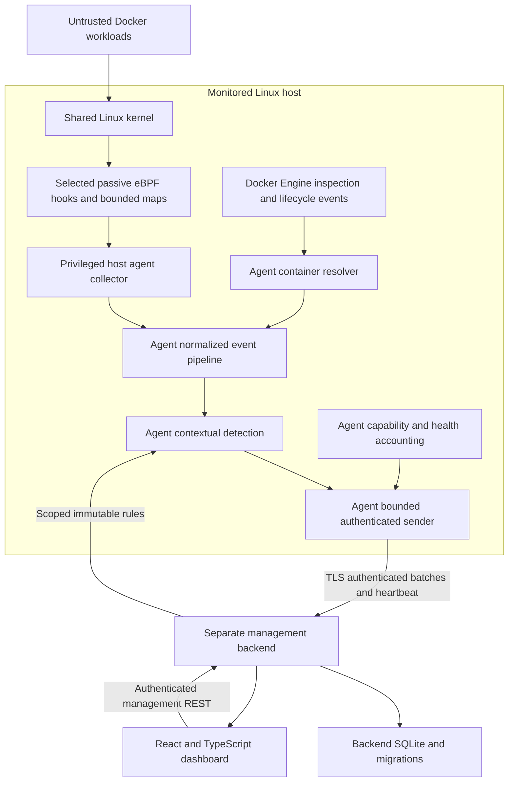

# System architecture

## Status, authority and scope

Phase 1 design only. Nothing in this document establishes that programs load, hooks exist, attribution works, APIs are implemented, or performance targets are met. The authority is [PROJECT_SPECIFICATION.md](../PROJECT_SPECIFICATION.md); this document elaborates its architecture without replacing it. Target deployment is Ubuntu 24.04 LTS, an actually probed Linux kernel, cgroup v2 and rootful Docker. macOS documentation work is not Linux validation. cgroup v1, rootless Docker and other runtimes require separate assessment.

Companion designs: [components](component-design.md), [data flow](data-flow.md), [threat model](threat-model.md), and [decisions](technical-decisions.md). [Event schema](event-schema.md), [API specification](api-specification.md) and [database design](database-design.md) are separately owned contracts. These architecture documents align with their Phase 1 contracts; their presence is not evidence of implementation.

## Deployment and ownership

The host agent owns observation and detection. The backend owns durable history, inventory, rule publication and REST; it does not load eBPF, resolve identities through a Docker socket, or independently rerun detection. The frontend owns presentation only and accesses REST through its service layer. Deploying management components with Docker Compose does not turn the agent into a container sidecar or grant management access to the monitored host.

| Boundary | Responsibilities | Must not do |
|---|---|---|
| Kernel C | Selected process, file, TCP and privilege observations; bounded records and loss counters | Rule evaluation, network delivery, string-based container attribution, enforcement |
| Host Go agent | Feature probes, attach lifecycle, decode, normalize, correlate Docker/cgroups, contextual rules, health, bounded transmission | Persist authoritative management history, kill/block workloads, trust labels as authorization |
| Management Go backend | Authenticate and scope agents/users; validate and atomically persist batches; inventory, rule revisions, queries, retention | Access Docker/kernel interfaces, silently redetect or rewrite original evidence |
| React/TypeScript frontend | Actual-data views, filters, rule-management UI, health/coverage indicators | Store agent secrets, call Docker, infer healthy coverage from absence of alerts |
| SQLite | Backend-owned transactional persistence with schema migrations | Be directly accessed by agents or browsers |

Kernel C and generated Go bindings remain separate from Go lifecycle logic. Proposed package boundaries and M1–M13 responsibilities are in the component design; paths and interfaces are design proposals, not existing source files. Cilium eBPF and bpf2go are the intended loader/binding tools; exact compatible dependencies and Clang/LLVM versions will be pinned only in the approved implementation phase.

## Contract baseline shared with the API owner

All endpoints use `/api/v1`. The following semantics are the architecture coordination baseline, not a complete HTTP specification. The API owner defines concrete DTOs, limits, error bodies, pagination, authentication provisioning and status codes in `api-specification.md`; the event-schema owner defines versioned events/alerts and their field encoding. Any incompatible change needs joint review of these five documents and those contracts before implementation.

| Operation | Required cross-component agreement |
|---|---|
| `POST /api/v1/agent/events` | The body contains `events` and `alerts` arrays. All new records commit in one backend transaction or none do. Idempotency uses host-scoped event/alert IDs and immutable canonical content, not a batch ID. Same ID with different content is a conflict, never an overwrite. Acknowledgment means durable commit, not HTTP receipt. Alert evidence must be included or retained for the authorized host/boot; an expired payload receipt is not usable evidence. |
| `POST /api/v1/agent/heartbeat` | Heartbeat carries host/boot/agent epoch, sequence, applied rule revision, capabilities/clock manifests, health and inventory state. Registered epochs and an active host lease protect current status. Inventory is one bounded complete snapshot, never chunks; its host-global revision advances by one across restarts. Only accepted complete snapshots can mark prior entries inventory-absent, never establish exact stop time. Oversize/incomplete collection sends health-only status and preserves stale inventory. |
| `GET /api/v1/agent/rules` | Authenticated agent receives only its assigned immutable rule-set revision, validation metadata and compatible schema. Poll with bounded interval/backoff/jitter; unchanged responses are permitted. Agent validates a complete set before atomically activating it and reports the active revision in heartbeat. Invalid or unavailable updates leave last-known-good rules active. |
| Standard management operations | Authenticated and authorized health, hosts, containers, event list/detail, alert list/detail, statistics, rule list/detail/publication and agent status. Filters, time ranges, pagination, retention and response bounds are API-owned. Report/export operations use bounded authorized queries, not unrestricted database access. |

Agent credentials bind to a registered agent and host; payload fields cannot choose a different principal. Management readers cannot ingest as an agent; agents cannot publish management rules or query other agents. TLS is required beyond a strictly isolated development setup. Browser-to-backend authentication is separate from agent authentication.

Events, alerts and rule revisions are immutable historical facts; labels, inventory and current agent status are mutable projections. Alert evidence records the active rule-set revision and rule version at evaluation time. Editing a rule creates a new immutable revision, not a replacement of the version used by old alerts. No backend connectivity is needed for evaluation with a valid active rule set; evidence delivery remains bounded and best-effort during outages.

## Reliability and timing model

- Every in-memory queue, pending resolver lookup, detection window, deduplication cache, batch and retry buffer has configurable record/byte/time limits. Queue-full behavior is explicit; the kernel cannot be backpressured into waiting for the backend.
- A bounded agent-local durable outbox preserves frozen events/alerts, original IDs/epochs, sequence and dedup decisions before network delivery. It is not the management database. Persist validated active rules and lifecycle identity state as specified by the shared contracts; revalidate before reuse. Capacity, disk-full, corruption, crash recovery and protected-file policies are explicit in the data flow. Pre-enqueue observations and unsaved counters can still be lost; durability is not lossless capture.
- Agent detection happens before batching. An event and its newly generated alerts form a delivery unit; overload must not silently deliver an alert without its evidence. Included evidence can be repeated with the same immutable ID across batches.
- Preserve kernel monotonic occurrence time, host/boot identity, conversion uncertainty and backend receipt time separately. Cross-host ordering is not inferred from wall clocks. Agent session identity scopes sequence/counter resets; boot identity scopes kernel IDs and monotonic time.
- A durable acknowledgment can be lost. Retry unchanged object IDs/content; batch grouping may change without changing documents or breaking evidence closure. Receipts survive while an ingestion epoch is open; closed epochs reject old delivery before receipt pruning. This is at-least-once attempted transmission with idempotent persistence, not end-to-end exactly-once observation.
- Late, unresolved, stale and degraded are explicit states. Zero alerts is not evidence of zero malicious behavior, complete coverage, or zero loss.
- Shutdown quiesces collection, drains within a deadline, then closes resources; forced discard and unacknowledged delivery are reported separately. See [data flow](data-flow.md) for stage policies and ordering.

## Kernel support and observation boundaries

Startup probes inspect the actual running kernel, architecture, BTF, CO-RE suitability, cgroup hierarchy, required program/map types, helpers, attach points and effective permissions/security policy. Loading and attaching a minimal intended program is stronger evidence than kernel version or a symbol's presence. Probes must distinguish unsupported from permission-denied, policy-denied and transient failures.

Process execution is the initial critical capability; inability to establish its required capture path prevents a ready monitoring state. Optional file, TCP and privilege paths may be disabled only with explicit degraded health and per-capability reasons. Fallback hooks are not semantic equivalents by default: preserve hook identity and attempted/succeeded/observed-state distinctions in events and publish the coverage change. The component design records candidate hooks and limitations. No hook is claimed validated in Phase 1.

## Security posture and deployment constraints

The agent is privileged host software and Docker access is effectively root-equivalent. Place it behind host service controls, restrict credentials and runtime files, and keep it off public management listeners. The backend and frontend need neither host privileges nor Docker socket mounts. Load only shipped, reviewed BPF artifacts; API clients cannot upload arbitrary BPF programs or executable detection rules.

Monitoring is passive. It may emit alerts and health information but must not deny syscalls, kill processes, terminate containers or change workload policy. Collection excludes file contents, network payloads, full environments and full command arguments by default. Bounded metadata can still be sensitive and requires authorization, retention and log redaction.

The [threat model](threat-model.md) documents trust assumptions, abuse cases and residual risks, including hostile workloads, compromised agents and kernels. This is a visibility system, not a security boundary against a malicious host administrator.

## Phase 1 review checkpoint

Before implementation approval, review these documents together with the event/API contracts for: atomic batch and ID semantics; evidence retention; inventory/session revisions; scoped rule distribution; actual-kernel probe matrix; queue budgets and loss accounting; and positive/negative attribution and detection test plans. Record unresolved decisions and later experiment evidence in their separately owned records. No code, dependency installation, compatibility result or benchmark is introduced by this design.
