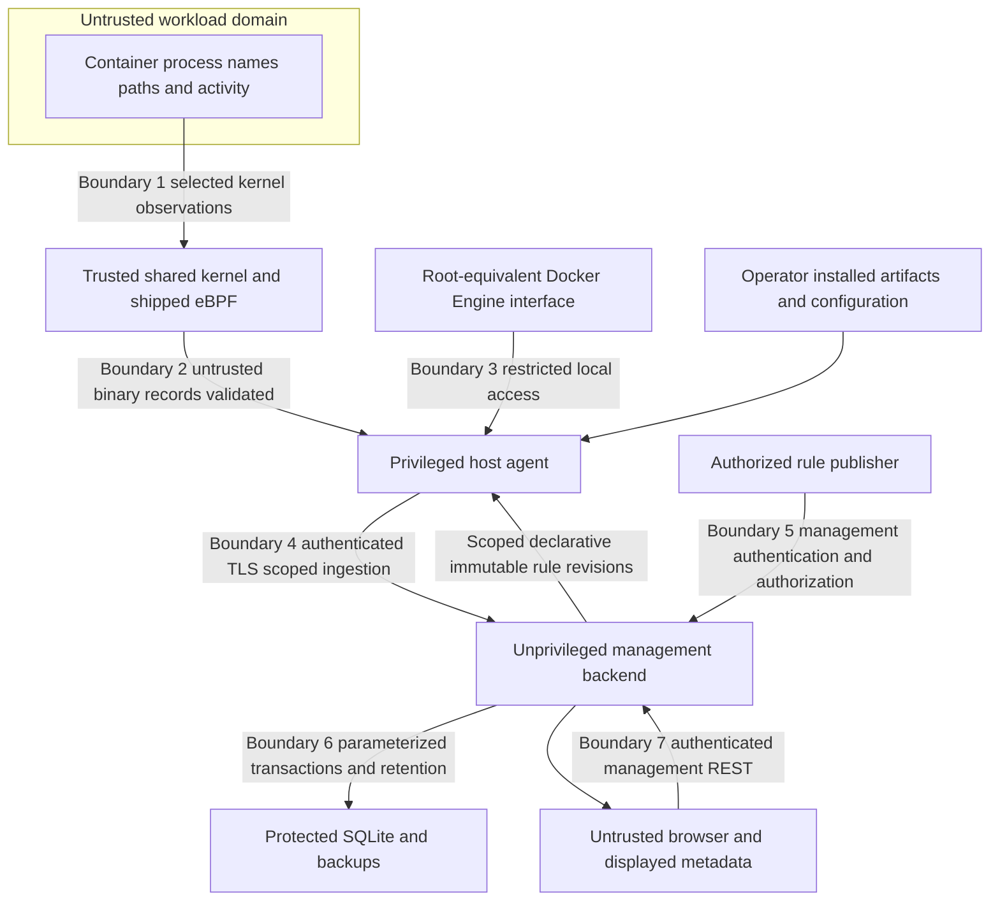

# Threat model and privilege boundaries

## Status, scope and assumptions

Phase 1 design review, not a penetration-test result or assurance claim. Scope is the eBPF host agent, Docker metadata correlation, agent/backend transport, backend SQLite and rule management, and browser dashboard. The canonical [specification](../PROJECT_SPECIFICATION.md), [system architecture](system-architecture.md), [components](component-design.md) and [data flow](data-flow.md) define the intended system.

Initial environment is a supported, actually probed Ubuntu 24.04 Linux host with rootful Docker and cgroup v2. Trusted operators control installation, shipped artifacts, agent enrollment, rule publication and host configuration. The baseline assumes the kernel, boot chain and host administrator are not malicious. A compromised host administrator/kernel can disable, forge or bypass this monitor; the system cannot establish its own integrity against that adversary.

Untrusted workloads may run arbitrary code with the privileges their deployment grants, intentionally generate events, exploit input parsing, use misleading names/labels/paths, and seek to evade selected hooks. External network clients and authenticated users/agents may also be hostile. Rule authors are authorized but may make mistakes; agent input is never trusted merely because it is authenticated.

### Assets and security objectives

- Host integrity: monitor installation must not expose Docker/kernel privilege through management features.
- Event/alert integrity and provenance: preserve source, identity uncertainty, rule revision and immutable evidence; prevent cross-agent modification or fabricated tenant/host scope.
- Availability and honest coverage: bound resource use and surface overload, stale state and unsupported hooks rather than claim complete observation.
- Confidentiality: protect credentials and sensitive runtime metadata; collect only necessary fields and enforce query/export/retention boundaries.
- Management integrity: only authorized actors may publish/assign rules; revisions and activation outcomes remain attributable.

Monitoring remains passive. Availability controls may drop monitoring data or reject API requests but must not block workload syscalls, terminate containers or kill workload processes.

## Trust boundaries

The diagram's trusted kernel assumption does not make every record safe to decode: workload-controlled values and incompatible/corrupt records still require validation. Similarly, authenticated agent reports are assertions from that agent, not independent proof of reality.

## Privilege and credential design

| Principal | Necessary access | Isolation requirement and residual risk |
|---|---|---|
| Agent service | Load/attach required BPF programs, read required kernel/cgroup/proc metadata, inspect Docker and read lifecycle events, transmit to its backend | Establish actual minimum effective permissions on the evaluated kernel, considering capabilities, LSM policy, lockdown and resource limits. Do not assert a fixed capability list suffices. Root or Docker socket access can still amount to complete host control. |
| Kernel programs | Only reviewed passive observation hooks and bounded maps/buffers | No arbitrary program upload, user-defined BPF, return-value modification, LSM denial, packet blocking or workload control. Verifier acceptance does not prove correct semantics or zero overhead. |
| Backend service | Its database directory, restricted server credentials, authorized network listeners | Run without BPF capabilities, host PID/cgroup privileges or Docker socket; do not mount the host filesystem. A backend compromise can still expose/alter its stored history and rule assignments. |
| Browser/user | Management API permission for assigned hosts and operations | No agent credentials or host interfaces. Separate read access from rule publication/export/administration. Browser compromise can misuse the user's granted permissions. |
| Agent credential | Ingest/heartbeat and fetch assigned rules for one registered scope | Cannot ingest for other hosts, publish rules or execute management commands. Protect files, rotation and revocation; never embed secrets in source, URLs or logs. |
| Rule publisher | Publish/assign validated revisions within authorized scope | No executable payloads or host-command channel. Require authenticated author identity and audit of publication/assignment; authorized malicious rules remain a residual risk. |

Docker API access is not safely read-only merely because the application chooses GET operations. A normal Docker socket allows privileged operations if the agent is compromised. Use a restrictive host service and, if later deployed, a carefully evaluated local inspection-only broker/proxy with explicit endpoint allowlisting. That proxy is an optional mitigation, not an implemented privilege separation or a new required service. Do not expose the socket over REST or mount it into the backend/frontend.

Separate privileged loading and unprivileged processing only if later implementation can preserve required operations and safely transfer ownership; Phase 1 does not claim such a split. Dropping some BPF capabilities after attachment does not remove root-equivalent Docker access. Prefer restrictive service users/filesystem permissions, protected credential directories, constrained egress and no public agent listener. Evaluate service hardening against actual attach/inspection needs instead of copying an untested sandbox profile.

Agent enrollment must bind authenticated identity to allowed host identity; reject contradictory payload host/agent IDs. TLS verifies backend identity and protects integrity/confidentiality. Agent authentication may use provisioned scoped tokens or mutual TLS as specified by the API/security owner; no mechanism is claimed implemented here. Session changes are authorized lifecycle transitions, not arbitrary payload values that can reset backend state. Rotation/revocation must stop future access; already leaked history cannot be recalled.

## Abuse cases, mitigations and remaining exposure

| Abuse / failure | Required design mitigation | Residual risk / validation obligation |
|---|---|---|
| Container floods exec/file/TCP activity to exhaust memory, CPU, ring buffer or alerts | Bounded buffers, workers, per-rule state/cardinality, batch/body sizes and writer queues; explicit drop counters and degraded health; bounded deduplication; cap active rule budgets | Workloads can still cause observation loss and compete for host CPU. Suppression can hide repeated behavior. Measure overhead/loss under load; no lossless claim. |
| Workload supplies malformed strings, surprising Unicode/control characters or ABI edge cases | Bound reads and lengths, validate decoder ABI/type/layout, reject malformed records, sanitize structured logs, render frontend text without HTML injection | Truncation can cause rule false negatives; compiler/layout bugs remain possible. Fuzz decoding and rendering; do not log full raw records. |
| Container name/cgroup path mimics a Docker ID or a benign host process | Require corroborated Docker inspection and host cgroup/process evidence; keep names/labels untrusted; include generation and event-time validity | Short-lived containers, missing permissions and races yield unresolved attribution. String/PID-only heuristics are prohibited, not fallback success. |
| PID/cgroup reuse, late event or Docker/agent restart causes false attribution | Boot/session and process-instance evidence, bounded historical validity intervals, reconciliation and stale-cache invalidation; reject ambiguous intervals | Gaps cannot always be reconstructed. Remain unresolved and surface reasons; test reuse, restarts and reordered lifecycle streams. |
| Privileged workload escapes or disables monitoring | Keep agent/control files outside workload mounts, minimize deployment privileges, report detach/heartbeat gaps, constrain monitored workload privileges operationally | Successful host compromise defeats local evidence and counters. Privileged containers and Docker socket mounts can cross the assumed boundary; visibility is not prevention. |
| Hook evasion through unobserved interfaces, namespace changes or misleading operation results | Publish actual hook/semantic coverage, attempted/success distinctions, missing fields and explicit optional-capability degradation | mmap/io_uring/other unmonitored paths, UDP/inbound traffic and alternative credential transitions may evade selected hooks. Absence of alerts is not safety evidence. |
| Forged, replayed or cross-host ingestion from network/client | TLS, scoped agent authentication, server-side host binding, body/schema limits, stable IDs/content checks, replay/idempotency window and authorized session transitions | A stolen credential or compromised genuine agent can forge plausible in-scope reports. Heartbeat presence is not remote attestation. |
| Lost acknowledgment/retry duplicates alerts or creates dangling evidence | Atomic event/alert/evidence transaction; immutable host-scoped event/alert IDs; conflicting ID rejection; receipts retained for open epochs and closed-epoch replay rejection | Crash before commit or local queue discard loses data. Commit with lost acknowledgment can leave delivery outcome unknown; counters must not pretend otherwise. |
| Agent/back-end outage or malicious stale heartbeat hides missing monitoring | Independent backend received-at staleness, monotonic session status, capability-level readiness, delivery/resolver/rule health | Total host outage also prevents last counters. Health is best-effort and may be deliberately falsified by a compromised agent. |
| Unauthorized or hostile rule publication disables detection or exhausts host resources | Management RBAC, scope assignment, immutable revision/audit, full agent validation of bounded typed declarative predicates/windows, no regex or executable language and atomic activation | Authorized publishers can still create broad allowlists or poor rules. Review changes, test benign/suspicious cases, display active revision and stale/LKG status. No arbitrary execution. |
| Partial/bad rule update produces inconsistent decisions | Validate entire snapshot and compatibility before activation; retain last-known-good; revision-specific state reset and warm-up reporting | Stale rules can miss new behavior; absent or invalid saved rules after startup/restart mean explicit detection unavailable. A rollback is a new revision, not erased history. |
| Browser injection or stolen session exposes runtime data/rules | Safe text rendering of names/paths/explanations, no unsafe HTML, authorization on every backend operation, secure session handling and HTTPS | If cookie authentication is chosen, require CSRF protection and appropriate cookie settings; restrict CORS to intended origins. XSS or stolen credentials can use permitted management functions. |
| API injection, abusive filters/exports or oversized inventory/rules | Parameterized SQL, schema validation, bounded request/decompression/query/response sizes, pagination, time/rate limits, server-side scope filtering | Authorized bulk access can still disclose permitted data; expensive authorized queries need measured limits. Reject incomplete inventory replacement. |
| Agent outbox/state theft, corruption or disk exhaustion | Restricted local files and credential separation, bounded durable records/age/dead letters, atomic ID/sequence/dedup/queue updates, integrity-checked recovery and revalidation of rules/lifecycle evidence | Metadata remains on the monitored host; root can alter it. Corruption or full disk can cause loss. Never silently regenerate IDs, relabel historical epochs or trust stale saved mappings. Encryption/key management needs deployment review. |
| Database theft, disk-full, retention bugs or malicious deletion | Restricted SQLite/WAL/backup files, migrations, foreign keys, controlled transactions, disk-pressure health, retention dependency closure and access controls | SQLite history is not tamper-evident against its administrator. Backups also contain sensitive data; encryption/key management depends on deployment policy. Deletion/retention reduces later forensic evidence. |
| Sensitive arguments, paths, destinations or labels leak through collection/logs | No file contents, payloads, full environment or full argv by default; bounded fields, redaction, restricted views/exports and retention | Even metadata reveals behavior and infrastructure. Allowlist/rule values may be sensitive. Minimize what is retained and document experiment consent. |
| Dependency/artifact compromise or version mismatch | Pin compatible tools/dependencies after approval, review shipped BPF artifacts, reproducible build records, validate generated ABI and reject incompatible schemas | Phase 1 has no verified dependency set or build provenance. CO-RE and verifier success do not establish semantic correctness. |

## Detection-specific integrity limits

Evidence-based alerts are hypotheses under declared rule and collection semantics, not proof of compromise. Shells and administration tools require context and benign tests. Unresolved identity must not be relabeled host to satisfy a selector. Allowlists can suppress actual attacks; duplicate suppression and correlation eviction must be visible. A rule requiring unavailable evidence returns insufficient evidence rather than a manufactured nonmatch. Cross-host correlation is not implied by host-local detection.

Backend persistence preserves the reported evidence and active rule revision but does not certify that a compromised agent observed it. Replaying stored events is a test/evaluation activity, not a production backend detection path. Synthetic fixtures must stay explicitly labelled in tests and never appear as collected dashboard data.

## Planned security review and acceptance evidence

Before implementation acceptance, execute and record negative authorization tests for every principal/host boundary; malformed/oversize/fuzz tests; conflicting/replayed ingestion and stale-session tests; partial inventory and rule-validation tests; Docker-unavailable/reuse/restart cases; load/cancellation/drain tests; frontend injection and session/CSRF checks where applicable; and database permission, disk-full, retention and evidence-integrity tests. On Linux, record actual minimum privileges, attach restrictions and passive hook behavior. No such checks or attack simulations were run for this documentation-only task.

Residual risks requiring explicit thesis disclosure: a shared compromised kernel/root defeats the monitor; selected hooks are incomplete; event-time attribution can remain unresolved; bounded buffering and outages lose evidence; clocks and lifecycle events have uncertainty; contextual rules produce false positives/negatives; backend administrators can modify stored history; and privileged metadata access increases deployment risk. The design is a passive research monitoring system, not a certified prevention, complete audit or tamper-proof forensic system.
